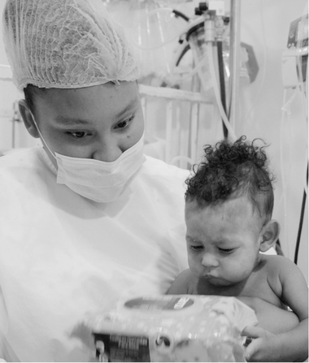
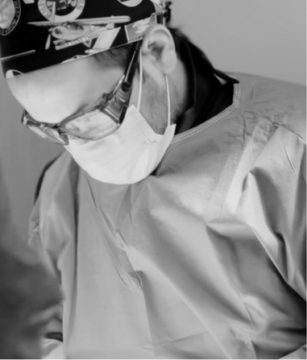

Cuidamos de ti y de los que amas Atención médica integral con calidad, calidez y confianza Solicitar una cita App Clem Resultados setREVStartSize({c: 'rev_slider_1_1',rl:[1240,1460,785,500],el:[705,600,580,580],gw:[1920,1440,778,480],gh:[705,800,680,580],type:'standard',justify:'',layout:'fullwidth',mh:"0"});if (window.RS_MODULES!==undefined && window.RS_MODULES.modules!==undefined && window.RS_MODULES.modules["revslider11"]!==undefined) {window.RS_MODULES.modules["revslider11"].once = false;window.revapi1 = undefined;if (window.RS_MODULES.checkMinimal!==undefined) window.RS_MODULES.checkMinimal()}

##### Bienvenidos a Clínica La Esperanza, un lugar donde cada cuidado nace del deseo de verte bien. Nuestro equipo te acompaña con dedicación y humanidad, integrando la ciencia médica con fé, amor y vocación de servicio, para brindarte una atención cercana y confiable.

Diagnóstico y tratamientos

### NUESTROS SERVICIOS MÉDICOS

###### Hospitalización

Más información

Nuestro servicio de hospitalización brinda cuidado integral y acompañamiento continuo para pacientes que requieren manejo intrahospitalario, con seguimiento médico y de enfermería enfocado en la seguridad y la recuperación. Contamos…

###### Cirugía

Más información

Nuestro servicio de Cirugía realiza la valoración y manejo quirúrgico de patologías frecuentes, con un enfoque seguro, oportuno y humanizado. Acompañamos al paciente en todo el proceso: evaluación prequirúrgica, preparación,…

###### Consulta externa

Más información

Brindamos atención médica programada para valoración, diagnóstico, tratamiento y seguimiento de pacientes. Nuestro enfoque es integral y humanizado, con especialistas que orientan cada caso, solicitan y analizan estudios cuando se…

###### Urgencias

Más información

Nuestro servicio de urgencias de mediana y alta complejidad está en la capacidad de atender cualquier tipo de urgencia médica, con una infraestructura amplia y renovada para la comodidad de…

Diagnóstico y tratamientos

# Los mejores servicios médicos y la mejor atención

En la Clínica La Esperanza, ofrecemos un diagnóstico preciso y tratamientos personalizados. Nuestro equipo médico se compromete a brindarte atención de calidad, con los mejores servicios y un enfoque integral para cuidar tu salud y bienestar.

#### Cirugía general y especialidades quirúrgicas

Más información

#### Medicina Especializada

Más información

#### Cuidados intensivos y hospitalización

Más información

#### Ortopedia y traumatología

Más información

### Voces de quienesya confiaron en nosotros

Laura Sofia Restrepo

Parto humanizado

Parto humanizado con acompañamiento continuo y la presencia de su pareja durante todo el proceso, en un entorno seguro y respetuoso, brindando apoyo emocional constante

[Botón: Leer historia completa](https://www.instagram.com/reel/DPCeDwpiXjJ/?igsh=OHYyeGdtczA4dWd3)

Johan Cruz Martínez

Corrección de quiste biliar

Cirugía de alta complejidad en la que se retiró el quiste de la vía biliar y se reconstruyó el paso de la bilis hacia el intestino, permitiendo restablecer su funcionamiento normal.

[Botón: Leer historia completa](https://www.instagram.com/reel/DXXwu0gB99N/?igsh=MW5zOWtpYzlybGI3OA==)

Dr. Pedro Vieira

Cirugía de columna

Intervención quirúrgica especializada en la columna para corregir la causa del dolor crónico, estabilizar la zona afectada y aliviar la compresión, permitiendo mejorar su movilidad y calidad de vida.

[Botón: Leer historia completa](https://www.instagram.com/reel/DOgPLN0jhs2/?igsh=MWlrb2FlYnY4c3JsOA==)

### Tu opinión nos ayuda a seguir mejorando la atención

[Botón: Comparte tu experiencia con nosotros](#)

### BRINDAMOS ATENCIÓN DE ALTA CALIDAD

##### ¡Agradecemos sinceramente su confianza! En Clínica La Esperanza, nuestros pacientes nos eligen porque reconocen nuestro compromiso con la excelencia y el cuidado que merecen.

[Botón: Contáctenos](https://clinicalaesperanza.co/agenda/)

[iframe: https://www.google.com/maps/embed?pb=!1m18!1m12!1m3!1d1971.7150429895157!2d-75.8920820359876!3d8.745540874205645!2m3!1f0!2f0!3f0!3m2!1i1024!2i768!4f13.1!3m3!1m2!1s0x8e5a30027861f5af%3A0x638e6790893b1b26!2zQ2wuIDEyICM0IC0gNTgsIE1vbnRlcsOtYSwgQ8OzcmRvYmE!5e0!3m2!1ses-419!2sco!4v1732536447107!5m2!1ses-419!2sco]

Qué hacemos

# Servicios

En la Clínica La Esperanza ofrecemos una amplia gama de servicios médicos especializados que cubren desde procedimientos quirúrgicos avanzados hasta atención médica integral. Contamos con áreas dedicadas a cirugía general, medicina especializada, cuidados intensivos y ortopedia, con un enfoque en la atención de calidad y el bienestar de nuestros pacientes.

#### Neurocirugía

Nuestros neurocirujanos expertos tratan enfermedades del sistema nervioso con precisión y cuidado.

Más información

#### Neurocirugía Infantil

La neurocirugía infantil brinda cuidados especializados y personalizados para el sistema nervioso de niños y adolescentes.

Más información

#### Medicina del dolor

La medicina del dolor trata el origen del dolor para mejorar la calidad de vida de los pacientes.

Más información

#### Oftalmología

Nuestros oftalmólogos brindan atención integral para cuidar y mejorar la visión y salud ocular.

Más información

### Mejora tu vida actuando ahora

Lo que hacemos

# Brindamos atención de alta calidad

¡Agradecemos sinceramente su confianza! En Clínica La Esperanza, nuestros pacientes nos eligen porque reconocen nuestro compromiso con la excelencia y el cuidado que merecen.

[Botón: Contáctenos](https://clinicalaesperanza.co/about-us/)

Contáctanos

# Clínica La Esperanza Montería Córdoba

Fé, Amor y Servicio

[Botón: Solicitar una cita](https://clinicalaesperanza.co/agenda/)

Dirección: Calle 12 # 4- 58

Barrio Buenavista

Montería - Córdoba

PBX: 7848903

Hospitalización:

Lunes a Domingo 10:00am a 12:00pm - 03:00pm a 05:00PM

UCI Adultos:

Lunes a Domingo 11:00am a 12:00pm

UCI Neonatal y pediatrica:

Lunes a Sábado 11:00am a 12:00pm

##### Nuestra ubicación

[iframe: https://www.google.com/maps/embed?pb=!1m18!1m12!1m3!1d1971.7150429895157!2d-75.8920820359876!3d8.745540874205645!2m3!1f0!2f0!3f0!3m2!1i1024!2i768!4f13.1!3m3!1m2!1s0x8e5a30027861f5af%3A0x638e6790893b1b26!2zQ2wuIDEyICM0IC0gNTgsIE1vbnRlcsOtYSwgQ8OzcmRvYmE!5e0!3m2!1ses-419!2sco!4v1732536447107!5m2!1ses-419!2sco]
