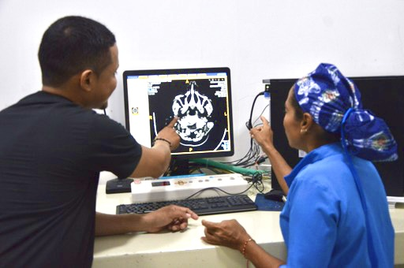
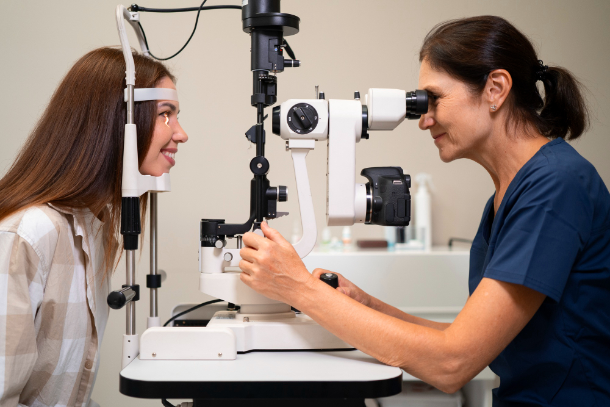
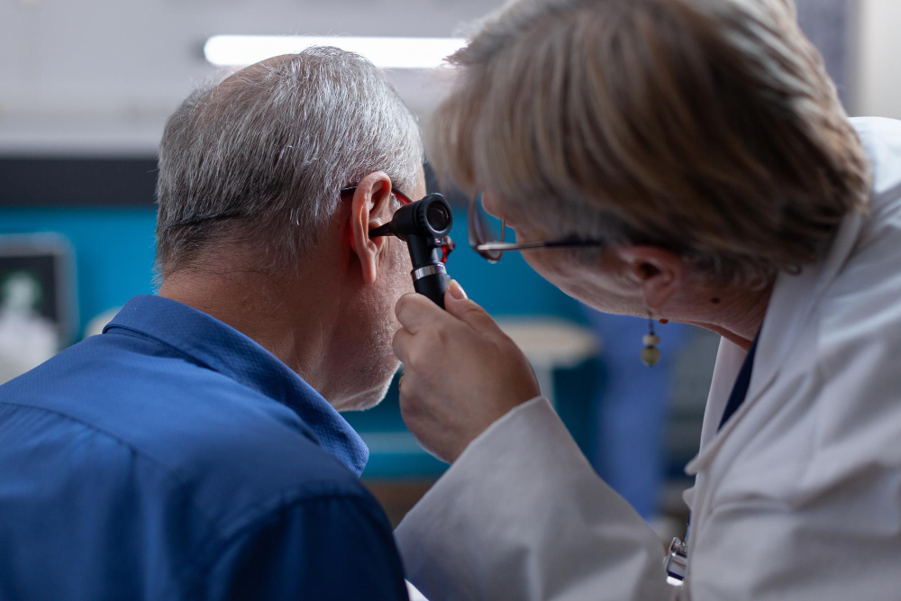
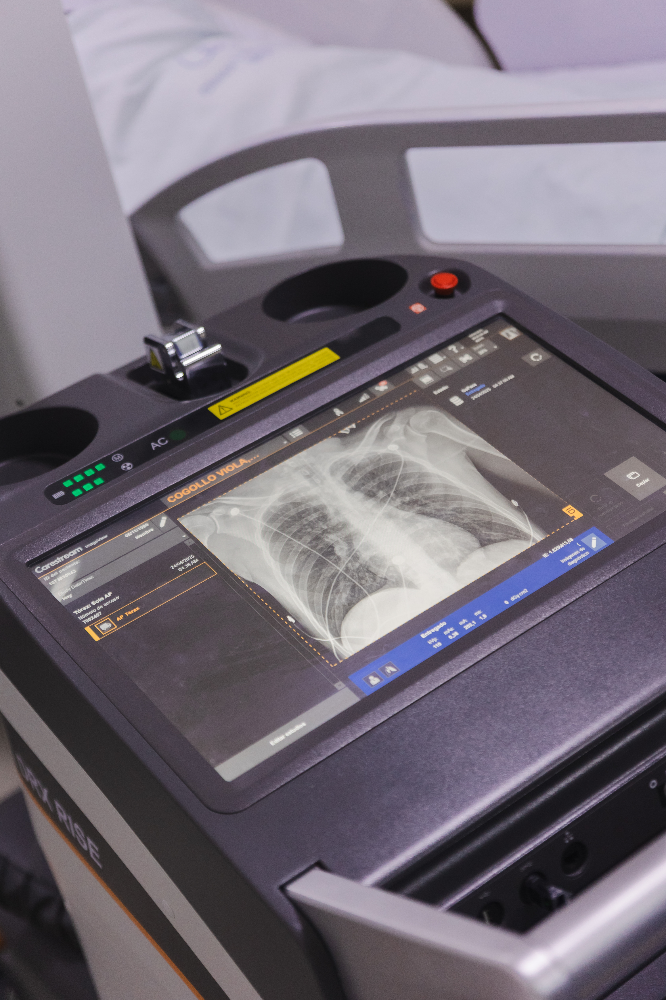
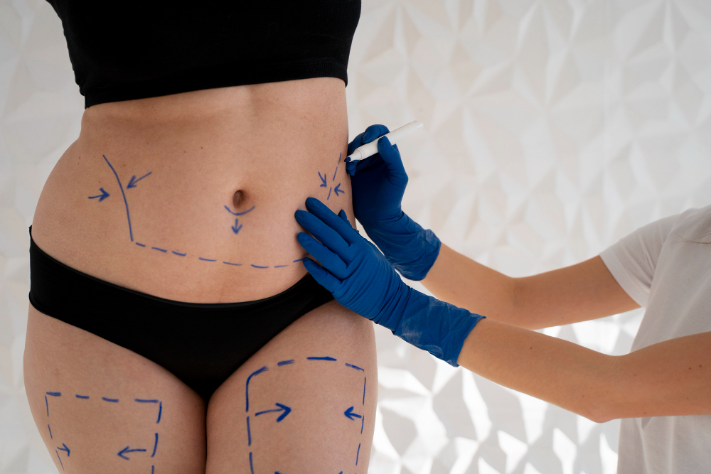
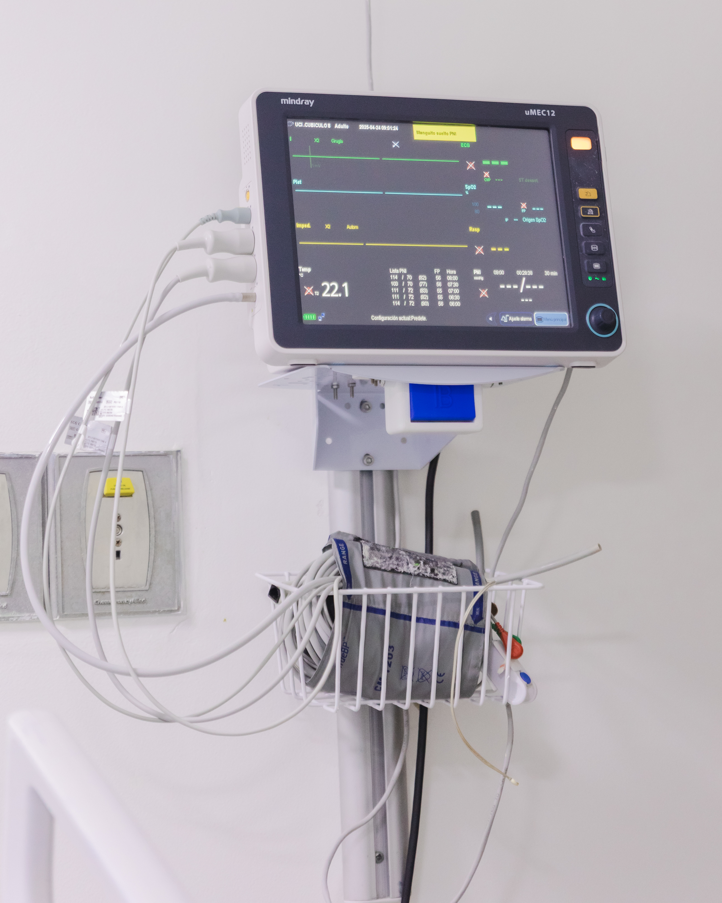

Clínica La Esperanza

# Los mejores servicios médicos y la mejor atención

En la Clínica La Esperanza, nos enfocamos en brindarte diagnósticos certeros y tratamientos a medida. Nuestro equipo médico está dedicado a ofrecerte una atención de calidad, con servicios especializados y un enfoque integral para garantizar tu salud y bienestar.

#### Neurocirugía

Nuestros neurocirujanos expertos tratan enfermedades del sistema nervioso con precisión y cuidado.

Más información

#### Neurocirugía Infantil

La neurocirugía infantil brinda cuidados especializados y personalizados para el sistema nervioso de niños y adolescentes.

Más información

#### Medicina del dolor

La medicina del dolor trata el origen del dolor para mejorar la calidad de vida de los pacientes.

Más información

#### Oftalmología

Nuestros oftalmólogos brindan atención integral para cuidar y mejorar la visión y salud ocular.

Más información

#### Otorrinolaringología

La otorrinolaringología proporciona atención integral para enfermedades del oído, nariz y garganta, abarcando tanto intervenciones quirúrgicas como medidas de rehabilitación.

Más información

#### Cirugía maxilofacial

La cirugía maxilofacial se especializa en el tratamiento de afecciones de la cara, los maxilares y la articulación temporomandibular, con un enfoque preciso y cuidadoso.

Más información

#### Cirugía de tórax

La cirugía de tórax se enfoca en el tratamiento quirúrgico de enfermedades del tórax, incluyendo pulmones y mediastino, con un enfoque en precisión y recuperación óptima.

Más información

#### Urología

La urología ofrece soluciones efectivas y personalizadas para afecciones del sistema urinario y la salud sexual masculina.

Más información

#### Cirugía cardiovascular

La cirugía cardiovascular ofrece un tratamiento preciso y eficaz para enfermedades que afectan los vasos sanguíneos.

Más información

#### Hematología infantil

La hematología infantil ofrece un manejo integral y especializado para enfermedades de la sangre en niños y adolescentes.

Más información

#### Cirugía General

La cirugía general se especializa en el tratamiento de patologías del sistema digestivo, la pared abdominal y tejidos blandos, con un enfoque en eficacia y recuperación óptima.

Más información

#### Ginecología y obstetricia

La ginecología y obstetricia se enfoca en la salud sexual y reproductiva de las mujeres, ofreciendo atención experta y personalizada en cada etapa de la vida.

Más información

#### Perinatología

La perinatología se especializa en el manejo de enfermedades y condiciones de alto riesgo durante y después del embarazo, garantizando una atención comprensiva para madres y bebés.

Más información

#### Cirugía pediátrica

La cirugía pediátrica se dedica al manejo y tratamiento quirúrgico de enfermedades en niños y adolescentes, con un enfoque compasivo y profesional.

Más información

#### Ortopedia y traumatología

La ortopedia y traumatología se enfoca en el diagnóstico y tratamiento de afecciones óseas y articulares, mejorando la calidad de vida con métodos avanzados y personalizados.

Más información

#### Cirugía plástica y reconstructiva

La cirugía plástica y reconstructiva ofrece soluciones precisas y personalizadas para mejorar la apariencia y funcionalidad del cuerpo, desde la corrección de defectos hasta mejoras estéticas.

Más información

#### Hospitalización

Nuestro servicio de hospitalización brinda cuidado integral y acompañamiento continuo para pacientes que requieren manejo intrahospitalario, con seguimiento médico y de enfermería enfocado en la seguridad y la recuperación. Contamos…

Más información

#### Cirugía

Nuestro servicio de Cirugía realiza la valoración y manejo quirúrgico de patologías frecuentes, con un enfoque seguro, oportuno y humanizado. Acompañamos al paciente en todo el proceso: evaluación prequirúrgica, preparación,…

Más información

#### Consulta externa

Brindamos atención médica programada para valoración, diagnóstico, tratamiento y seguimiento de pacientes. Nuestro enfoque es integral y humanizado, con especialistas que orientan cada caso, solicitan y analizan estudios cuando se…

Más información

#### Urgencias

Nuestro servicio de urgencias de mediana y alta complejidad está en la capacidad de atender cualquier tipo de urgencia médica, con una infraestructura amplia y renovada para la comodidad de…

Más información
