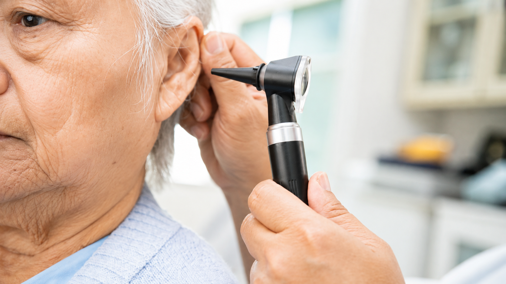

[Botón: Inicio](https://clinicalaesperanza.co/portafolio/)

[Botón: Volver a servicios](https://clinicalaesperanza.co/p-consulta-externa/)

## Otorrinolaringología

Cuidado especializado de oído, nariz y garganta.

## Escuchar, respirar y comunicarnos

El oído, la nariz y la garganta cumplen funciones esenciales en nuestra vida cotidiana. Nuestro servicio de Otorrinolaringología ofrece valoración especializada para identificar y tratar alteraciones que pueden afectar estas funciones.

#### ATENCIÓN ESPECIALIZADA

#### Nuestros Servicios

Oído

Evaluación y tratamiento de alteraciones auditivas, infecciones, vértigo y otras condiciones del oído.

Nariz y senos paranasales

Atención de problemas respiratorios, sinusitis, obstrucciones y otras alteraciones nasales.

Garganta y voz

Valoración de enfermedades de la garganta, dificultades para tragar y alteraciones de la voz.

#### Atención para diferentes edades

#### Una especialidad para toda la familia.

La Otorrinolaringología atiende las necesidades de niños, adolescentes y adultos, adaptando la valoración y el tratamiento a cada etapa de la vida.

Pediatría

Adultos

# Cuida tu oído, nariz y garganta

Cuidado Crítico · Clínica La Esperanza · Montería

[Botón: Conoce más](#)
