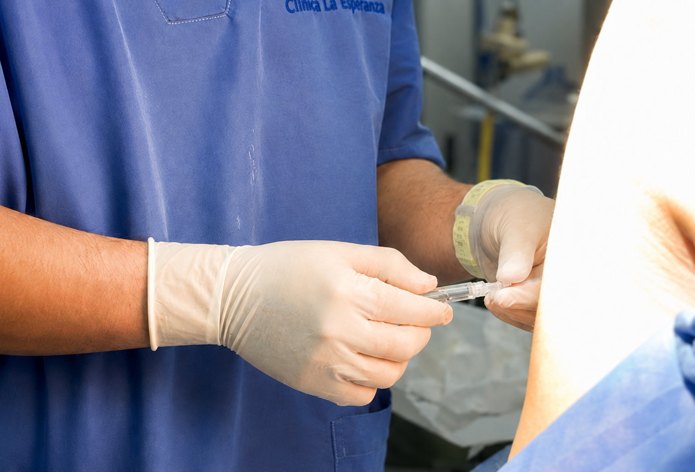
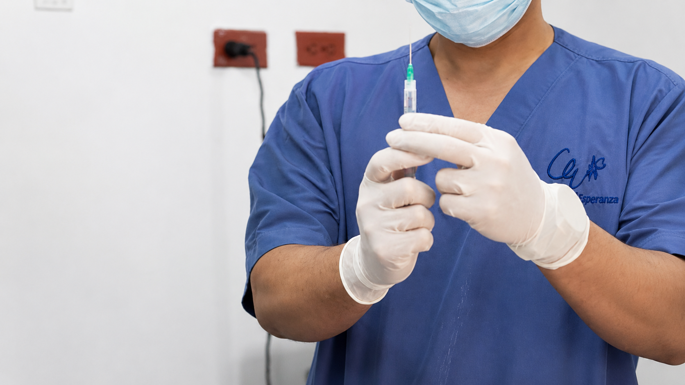
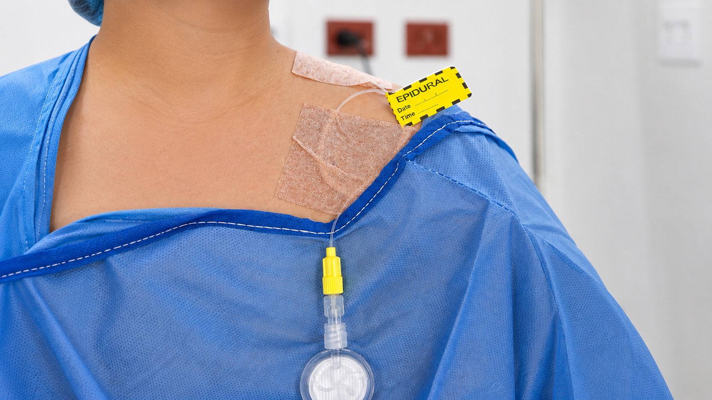

[Botón: Inicio](https://clinicalaesperanza.co/portafolio/)

[Botón: Volver a servicios](https://clinicalaesperanza.co/portafolio/)

## Anestesiología

Un equipo dedicado a que cada procedimiento sea seguro, cómodo y libre de dolor.

#### Anestesia pensada en tu tranquilidad

Contamos con un equipo de anestesiología especializado en acompañar cada procedimiento con las técnicas más adecuadas para tu seguridad y confort, desde la sedación hasta el control avanzado del dolor.

#### Nuestros servicios

#### Bomba de Manejo del Dolor

Sistema de infusión continua de analgesia para procedimientos y cirugías, pensado para lograr una recuperación con el mínimo dolor posible.

#### Consulta Preanestésica

Valoración previa a la cirugía para planear el tipo de anestesia más seguro según tu condición de salud.

#### Bloqueos Nerviosos y Anestesia Regional

Técnicas dirigidas para controlar el dolor en zonas específicas del cuerpo, reduciendo la necesidad de anestesia general.

#### Sedación para Procedimientos Ambulatorios

Manejo seguro y controlado de la sedación en procedimientos fuera de quirófano.

#### Manejo del Dolor

Evaluación y tratamiento especializado para pacientes con dolor agudo o crónico asociado a procedimientos médicos y quirúrgicos.

#### ¿Por qué elegirnos?

#### Equipo especializado

Anestesiólogos con experiencia en procedimientos de baja y alta complejidad.

#### Seguridad ante todo

Monitoreo continuo y protocolos estrictos en cada procedimiento.

#### Acompañamiento personalizado

Planeamos el tipo de anestesia según tu caso particular.

# Procedimientos sin dolor, con total confianza

Agenda tu valoración con nuestro equipo de anestesiología.
