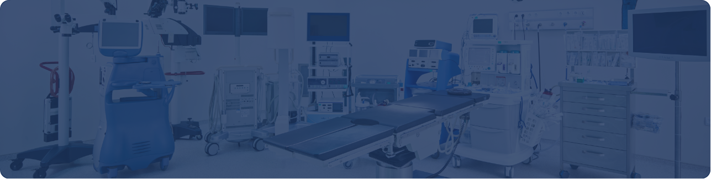

[Botón: Inicio](https://clinicalaesperanza.co/portafolio/)

[Botón: Volver a servicios](https://clinicalaesperanza.co/portafolio/)

# Centro de Intervencionismo Cardiovascular

Procedimientos cardiovasculares de mínima invasión, con tecnología de punta.

Contamos con una sala especializada para el diagnóstico y tratamiento de enfermedades cardiovasculares mediante procedimientos de mínima invasión, respaldada por equipos de tecnología avanzada y un equipo clínico altamente capacitado.

#### Nuestra tecnología

Equipo

Marca /Modelo

Función

Descripción

Estación de anestesia

Dräger AtlanA300

Soporte anestésico integral durante procedimientos de hemodinamia

Plataforma central que integra monitoreo y ventilación anestésica de alta precisión

Monitor multiparámetro

Dräger Vista300

Monitoreo continuo de signos vitales del paciente

Parte de la configuración de la estación de anestesia; seguimiento en tiempo real durante el procedimiento

Módulo de monitoreo deprofundidad anestésica

BIS Covidien

Medición del nivel de conciencia/profundidad anestésica

Permite ajustar la anestesia con mayor precisión y seguridad

Monitor de bloqueoneuromuscular

TOFscan

Monitoreo del grado de relajación muscular

Contribuye a una dosificación anestésica más segura y controlada

#### Equipos en proceso de confirmación

#### Bombas de infusión volumétricas

Administración controlada de líquidos y medicamentos IV

#### Bombas de jeringa

Administración precisa de medicamentos en dosis controladas

#### Inyector de medio de contraste

Inyección automatizada de contraste para estudios de imagen

#### Polígrafo / sistema de registro electrofisiológico (mín. 64 canales)

Registro y análisis de señales electrofisiológicas durante el procedimiento

La información de equipos en proceso de confirmación se actualizará una vez se definan las referencias definitivas.

# Comunícate con nosotros

AppCLEM (App Store / Google Play) · Calle 12 # 4-58, Barrio Buenavista · PBX 7848903 · info@clinicalaesperanza.co
