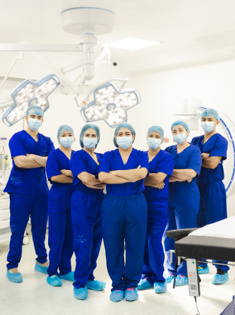
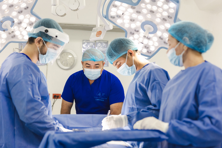
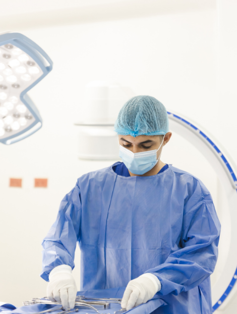

[Botón: Inicio](https://clinicalaesperanza.co/portafolio/)

[Botón: Volver a servicios](https://clinicalaesperanza.co/portafolio/)

## Unidad Quirúrgica

Infraestructura, tecnología y especialistas para procedimientos de baja, mediana y alta complejidad.

Ofrecemos soluciones quirúrgicas especializadas, diseñadas para responder a las necesidades de cada paciente con precisión, seguridad y calidad. Contamos con un equipo médico altamente capacitado y tecnología de vanguardia, lo que garantiza resultados confiables y una atención humana en cada procedimiento.

#### Capacidad instalada

2 Quirófanos

Salas completamente dotadas para procedimientos de baja, mediana y alta complejidad.

1 Sala de Partos

Espacio diseñado para una atención segura y humanizada durante el nacimiento.

8 Camas de Recuperación

Monitoreo permanente y atención especializada durante el postoperatorio.

#### ¿Por qué elegirnos?

Equipo altamente capacitado

Cirujanos y personal clínico con amplia experiencia en cada especialidad.

Tecnología de vanguardia

Equipos e instalaciones pensados para procedimientos seguros y precisos.

Resultados confiables

Procesos rigurosos que priorizan tu seguridad en cada etapa del procedimiento.

Atención humana

Acompañamiento cercano para ti y tu familia durante todo el proceso.

#### Áreas quirúrgicas especializadas

- Cirugía Pancreatohepatobiliar

- Cirugía de Tórax

Procedimientos enfocados en el cuidado y tratamiento quirúrgico del corazón y los vasos sanguíneos.

Procedimientos orientados a la reconstrucción y el bienestar estético del paciente.

Procedimientos quirúrgicos adaptados a las necesidades particulares de los niños, en distintas especialidades.

Procedimientos especializados en el sistema nervioso central y periférico.

- Ortopedia Oncológica

- Artroscopia

- Ortopedia Reconstructiva

- Cirugía de Hombro

- Revisión de Prótesis

- Cirugía de Columna

- Ginecología Oncológica

- Ginecología Laparoscópica

Procedimientos especializados en el sistema urinario y reproductor.

Procedimientos especializados en oído, nariz y garganta.

Procedimientos quirúrgicos para el cuidado y tratamiento de la visión.

Procedimientos especializados en la región facial, oral y maxilar.

#### Conoce nuestras Unidad Quirúrgica

# Cuidado innovador, pensado para ti

Clínica La Esperanza · Montería
