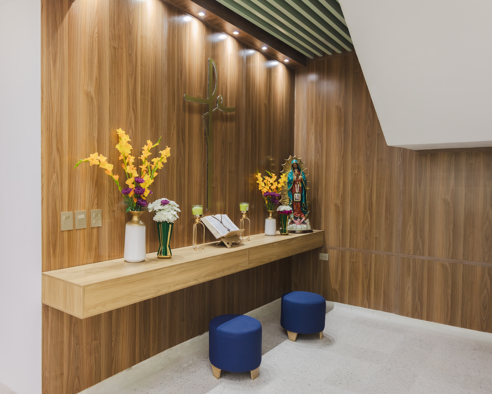
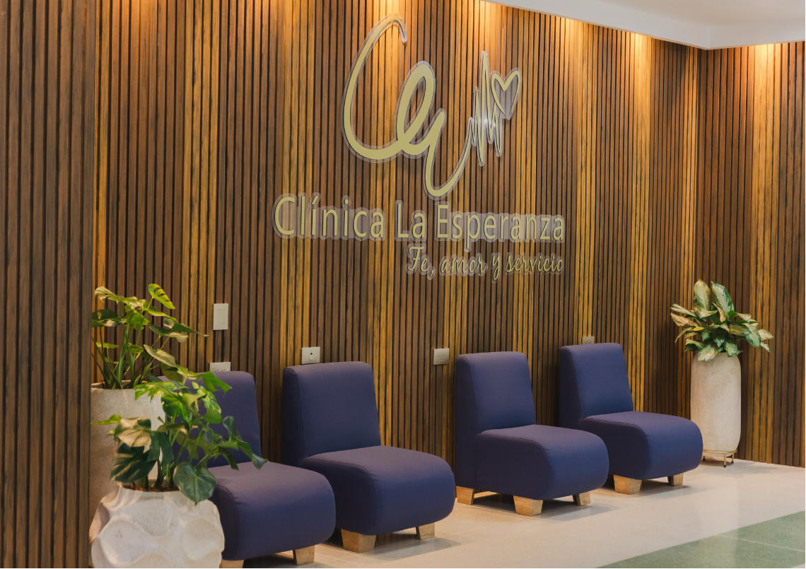

[Botón: Inicio](https://clinicalaesperanza.co/portafolio/)

[Botón: Volver a servicios](https://clinicalaesperanza.co/portafolio/)

## Consulta Externa Especializada

En Clínica La Esperanza ofrecemos un servicio de Consulta Externa respaldado por especialistas de diferentes áreas, consultorios modernos y una atención centrada en el paciente.

#### Consultorios modernos y confortables

Nuestros consultorios están diseñados para brindar una experiencia cómoda y segura tanto para pacientes como para profesionales de la salud. Cada espacio favorece una atención médica eficiente, con ambientes adecuados para la valoración, el diagnóstico y el seguimiento clínico.

#### Especialidades médico-quirúrgicas

[Botón: Conoce más](https://clinicalaesperanza.co/p-pediatria-2/)

Medicina Interna

[Botón: Conoce más](https://clinicalaesperanza.co/p-medicina-interna/)

Neurocirugía​

[Botón: Conoce más](https://clinicalaesperanza.co/p-sub-neurocirugia/)

[Botón: Conoce más](https://clinicalaesperanza.co/p-ginecologia-y-obstetricia/)

Ortopedia y Traumatología

[Botón: Conoce más](https://clinicalaesperanza.co/p-sub-ortopedia-y-traumatologia/)

Cirugía general

[Botón: Conoce más](https://clinicalaesperanza.co/p-sub-cirugia-general/)

[Botón: Conoce más](https://clinicalaesperanza.co/p-sub-salud-mental/)

[Botón: Conoce más](https://clinicalaesperanza.co/p-sub-radiologia/)

[Botón: Conoce más](https://clinicalaesperanza.co/p-sub-fisioterapia/)

Cirugía Cardiovascular

[Botón: Conoce más](https://clinicalaesperanza.co/p-sub-cirugia-cardiovascular/)

Cirugía Plástica​

[Botón: Conoce más](https://clinicalaesperanza.co/p-sub-cirugia-plastica/)

Urología

[Botón: Conoce más](https://clinicalaesperanza.co/p-sub-urologia/)

Cirugía Maxilofacial

[Botón: Conoce más](https://clinicalaesperanza.co/p-sub-cirugia-maxilofacial/)

Otorrinolaringología​

[Botón: Conoce más](https://clinicalaesperanza.co/otorrinolaringologia/)

Neurología

[Botón: Conoce más](https://clinicalaesperanza.co/p-sub-neurologia/)

[Botón: Conoce más](https://clinicalaesperanza.co/p-sub-nutricion-y-dieta/)

Medicina Física y Rehabilitación

[Botón: Conoce más](https://clinicalaesperanza.co/p-sub-medicina-fisica-y-rehabilitacion/)

Anestesiología

[Botón: Conoce más](https://clinicalaesperanza.co/p-anestesiologia/)

[Botón: Conoce más](https://clinicalaesperanza.co/p-sub-fonaudiologia/)

Oftalmología y Oculoplastia

[Botón: Conoce más](https://clinicalaesperanza.co/p-sub-oftamologia-y-oculoplastia/)

Alergología

[Botón: Conoce más](https://clinicalaesperanza.co/p-sub-alergologia/)

Dermatología

[Botón: Conoce más](https://clinicalaesperanza.co/p-sub-dermatologia/)

#### ¿Qué ofrecemos en Consulta Externa?

Atención por especialistas

Consultorios modernos y cómodos

Agenda de citas programadas

Atención humanizada

Valoración y seguimiento médico

Pacientes particulares y convenios

#### Espacios pensados para el bienestar del paciente

#### Consulta Externa en cifras

20+

Consultorios habilitados

5+

Consultorios habilitados

10.000+

Consultas al año

30+

equipo médico multidisciplinario

# Atención especializada con calidad y confianza

En Clínica La Esperanza ponemos a disposición de nuestros pacientes, empresas y aliados un servicio de Consulta Externa respaldado por talento humano, infraestructura moderna y un compromiso permanente con la excelencia en la atención.
