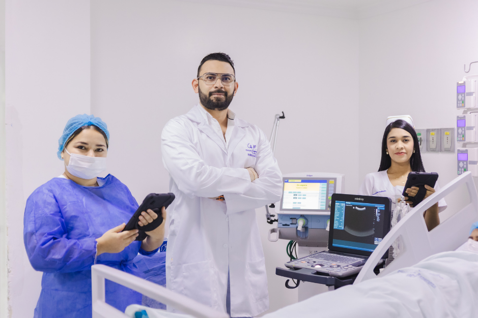
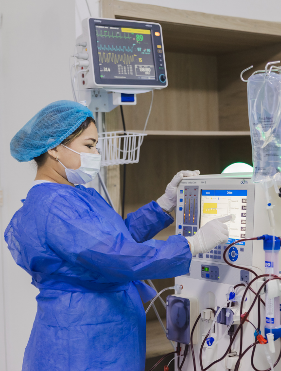
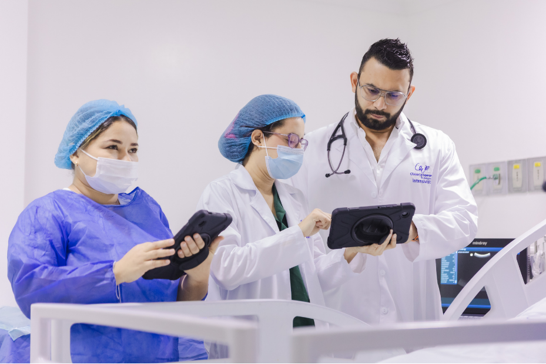
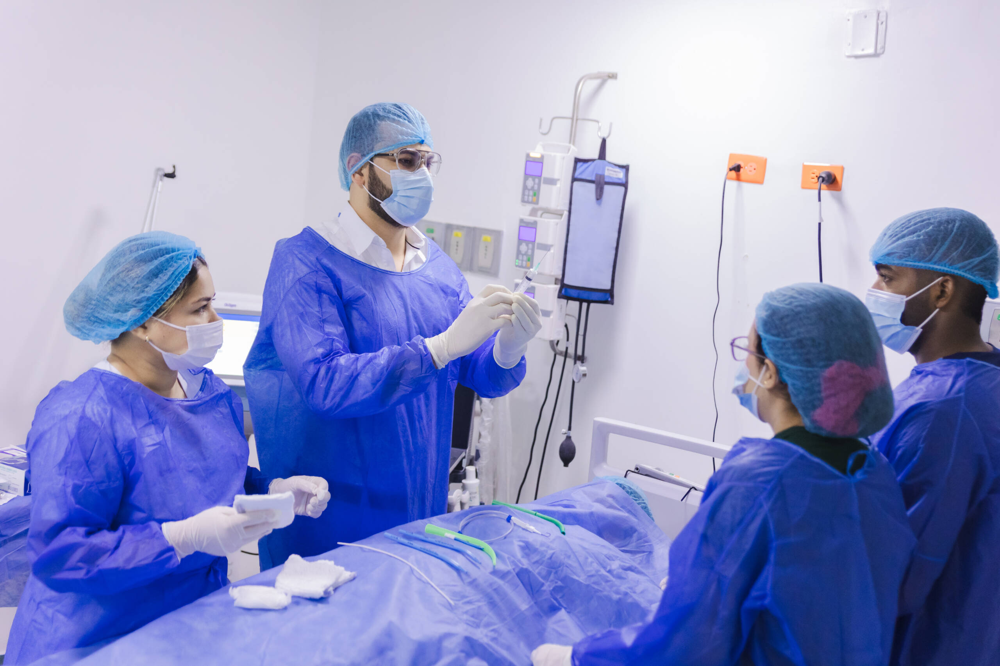
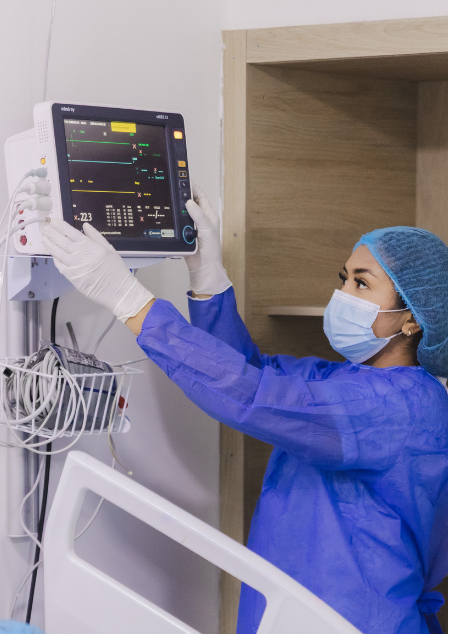

[Botón: Inicio](https://clinicalaesperanza.co/portafolio/)

[Botón: Volver a servicios](https://clinicalaesperanza.co/portafolio/)

## Cuidado Crítico

Unidades especializadas para pacientes en estado crítico.

En Clínica La Esperanza contamos con unidades de Cuidado Crítico dotadas con tecnología especializada, dirigidas a pacientes adultos, pediátricos y neonatales que requieren monitoreo y vigilancia permanente. Nuestro equipo asistencial trabaja de manera integral para brindar una atención segura en cada etapa del proceso.

#### Monitoreo y vigilancia permanente

Nuestras unidades de Cuidado Crítico cuentan con cubículos dotados con toda la tecnología para garantizar la monitorización del paciente, atendidos por personal de salud altamente calificado y dedicado a los casos más críticos.

#### ¿Qué encontrarás en nuestras Unidades de Cuidado Crítico?

#### UCI Adultos

Cuidados intensivos para pacientes adultos en estado crítico.

#### UCIM

Cuidados intermedios para pacientes que requieren monitoreo especializado.

#### UCI Neonatal

Atención a recién nacidos prematuros o con patologías neonatales.

#### UCI Pediátrica

Cuidados intensivos para niños en estado crítico.

#### Monitoreo permanente

Vigilancia continua por personal de salud calificado.

#### Equipo interdisciplinario

Médicos especialistas, enfermería y terapia física y respiratoria.

#### Tecnología especializada

Cubículos dotados con equipos para la monitorización del paciente.

#### Articulación con la Clínica

Conexión con otros servicios cuando el paciente lo requiere.

#### Contamos con:

14 cubículos de Cuidados Intensivos e Intermedios Adulto

14 incubadoras

17 cunas

2 camas pediátricas (UCI Neonatal y Pediátrica)

#### Conoce nuestras Unidades de Cuidado Crítico

# Cuidado especializado, en cada etapa de la vida

Cuidado Crítico · Clínica La Esperanza · Montería
