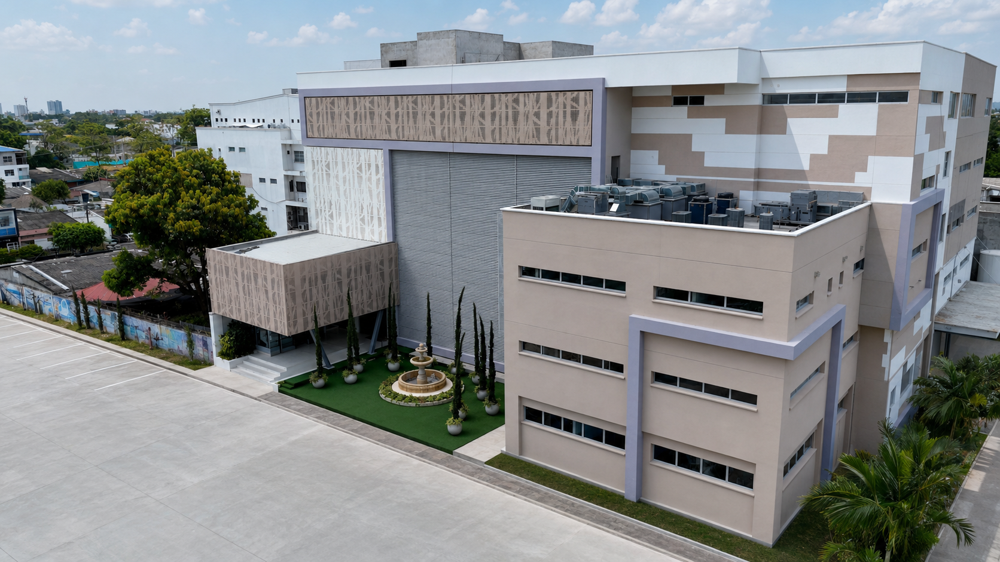

## Hospitalización

Cuidamos de ti en cada etapa de tu recuperación.

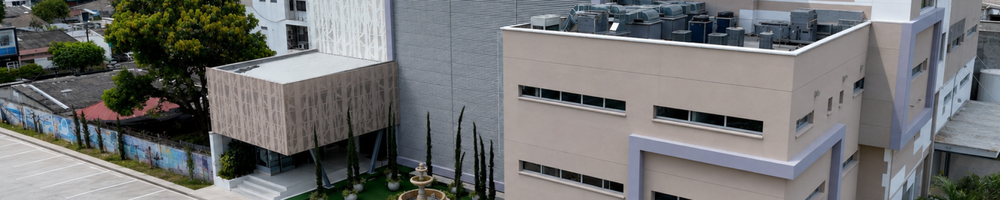

## Hospitalización

Cuidamos de ti en cada etapa de tu recuperación.

## Suite VIP

Nuestra experiencia premium de hospitalización.

La Suite Serena representa el máximo nivel de comodidad dentro de nuestra institución. Fue diseñada para brindar una experiencia exclusiva durante la hospitalización, combinando privacidad, amplitud y servicios diferenciados para el paciente y su acompañante.

[Botón: Solicitar información](#)

La Habitación Estándar ofrece un espacio cómodo, seguro y funcional, pensado para brindar una estancia agradable con la calidad y el cuidado que caracterizan a la Clínica La Esperanza.

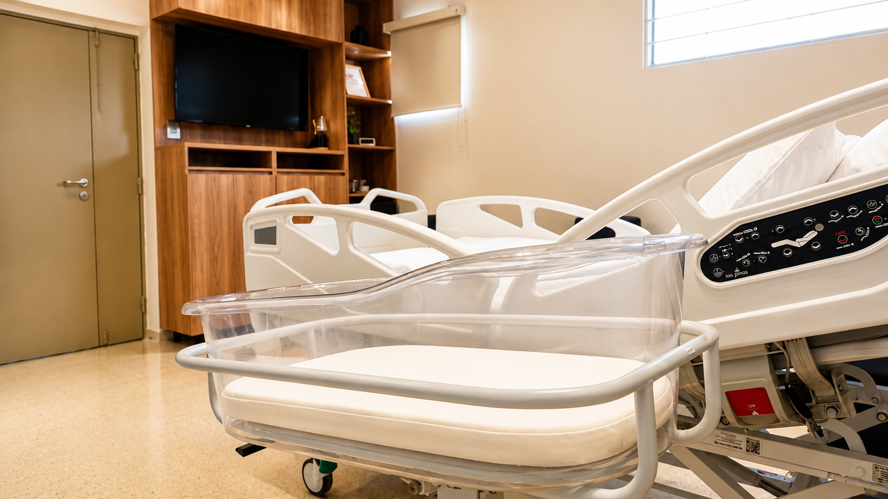

#### Habitación Estándar

#### Comodidad y bienestar para tu recuperación.

La Habitación Estándar ofrece un espacio cómodo, seguro y funcional, pensado para brindar una estancia agradable con la calidad y el cuidado que caracterizan a la Clínica La Esperanza.

Habitación privada

Baño privado

Aire acondicionado

Televisión

Alimentación

Atención médica

Enfermería 24h

Acompañante

[Botón: Conoce más](#)

#### Habitación Plus

#### Mayor confort para una estancia más agradable.

La Habitación Plus está diseñada para quienes desean disfrutar de un ambiente más amplio, moderno y confortable durante su proceso de recuperación.

Habitación privada

Baño privado

Aire acondicionado

Televisión

Nevera

Estación de café

Espacios amplios

Acompañante

[Botón: Conoce más](#)

[Botón: Premium](#)

#### Suite Serena

#### Nuestra experiencia premium de hospitalización.

La Suite Serena representa el máximo nivel de comodidad dentro de nuestra institución. Fue diseñada para brindar una experiencia exclusiva durante la hospitalización, combinando privacidad, amplitud y servicios diferenciados para el paciente y su acompañante.

Suite privada

Baño privado

Kit de aseo

Televisión

Menú especial

Estación de café

Experiencia premium

Nevera

Espacio acompañante

Menú dif. acompañante

[Botón: Conoce más](#)

#### Habitación

#### Habitación Estandar

Un espacio cómodo, seguro y funcional para una recuperación tranquila, con baño privado y un entorno pensado para el paciente y su acompañante.

[Botón: Volver a servicios](https://clinicalaesperanza.co/p-suite-vip/)

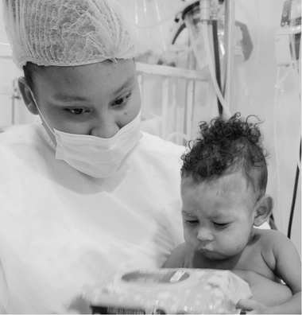

Contamos con una oferta integral de servicios de mediana y alta complejidad.

Nuestra gestión se orienta al mejoramiento continuo, la innovación y el fortalecimiento de las capacidades institucionales, consolidando una oferta de servicios que responde a los desafíos actuales del sector salud.

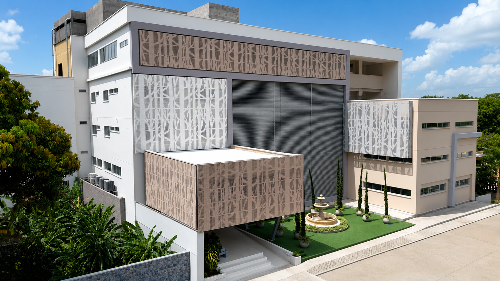

Lorem fistrum por la gloria de mi madre esse jarl aliqua llevame al sircoo. De la pradera ullamco qué dise usteer está la cosa muy malar.

#### Capacidad instalada

Construimos el futuro de la atención en salud a través de un proyecto de expansión que fortalecerá nuestra capacidad instalada.

#### 60

Camas adultos

#### 16

Camas pediatría

#### 14

UCI/UCIM adultos

#### 38

Cubículos urgencias

#### 2

Salas de cirugía

#### 123

Camas habilitadas

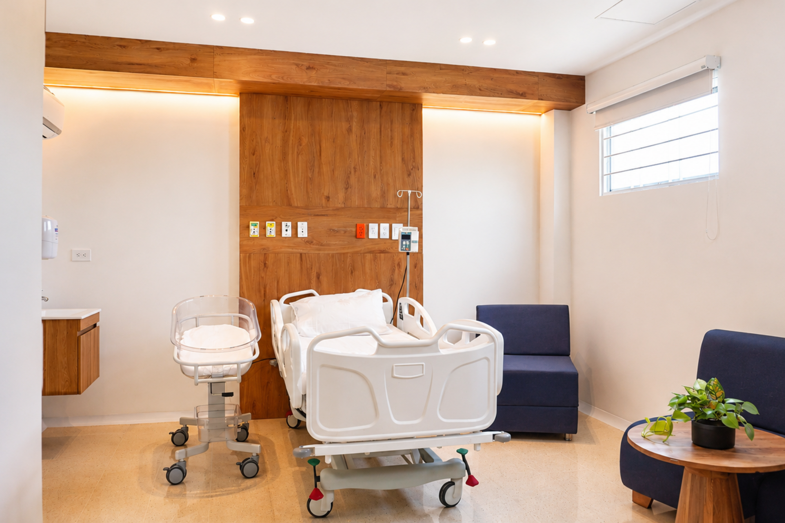

Urgencias

Cuidado Crítico

Cirugía

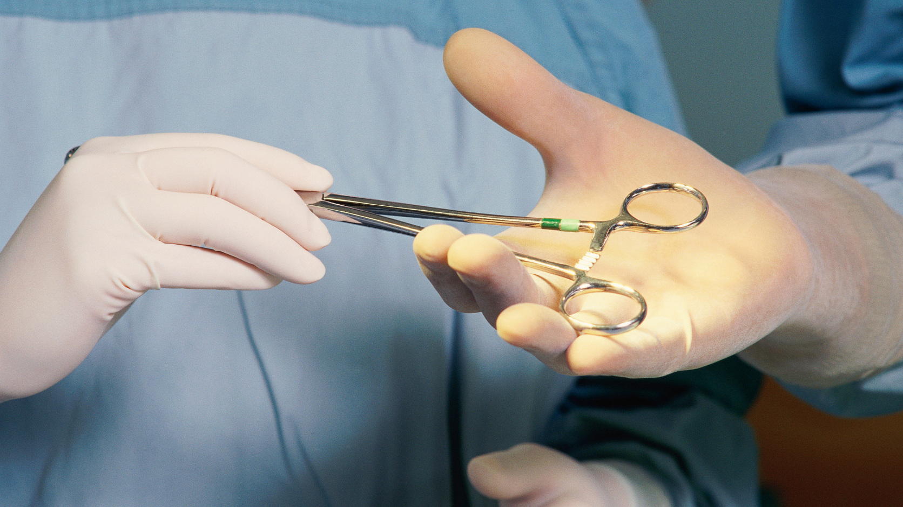

Johan Cruz Martinez

Cirugía de alta complejidad en la que se retiró el quiste de la vía biliar y se reconstruyó el paso de la bilis.

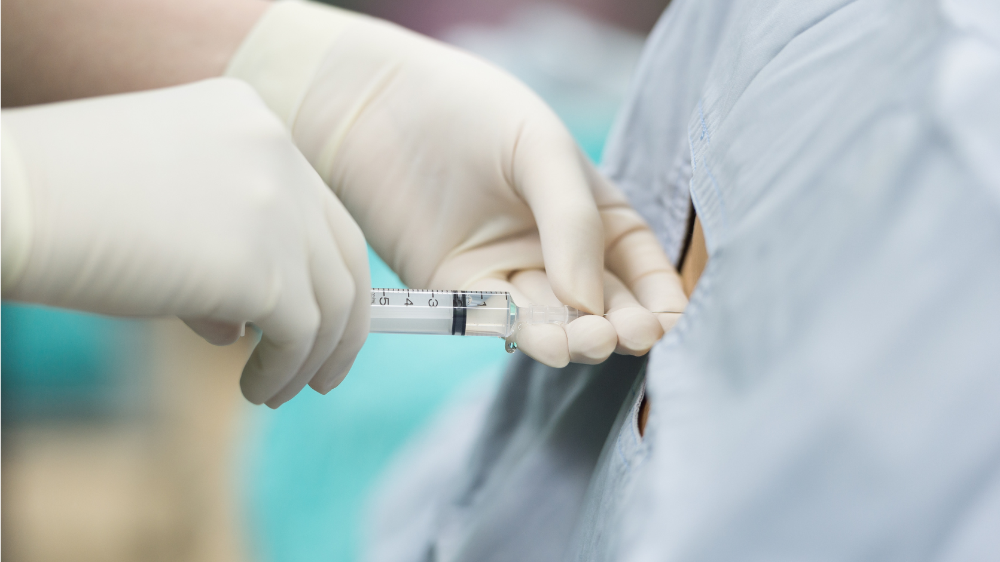

Cirugía de columna

Intervención quirúrgica especializada para corregir la causa del dolor crónico.

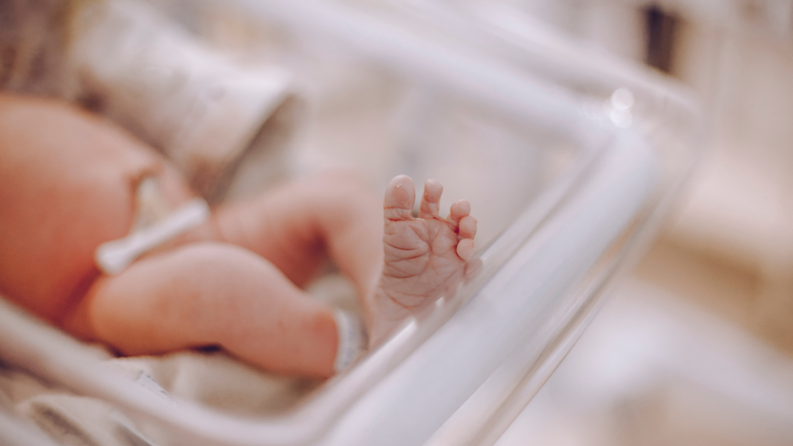

Parto humanizado

Experiencia de nacimiento respetuosa, segura y acompañada.

Cuidado crítico

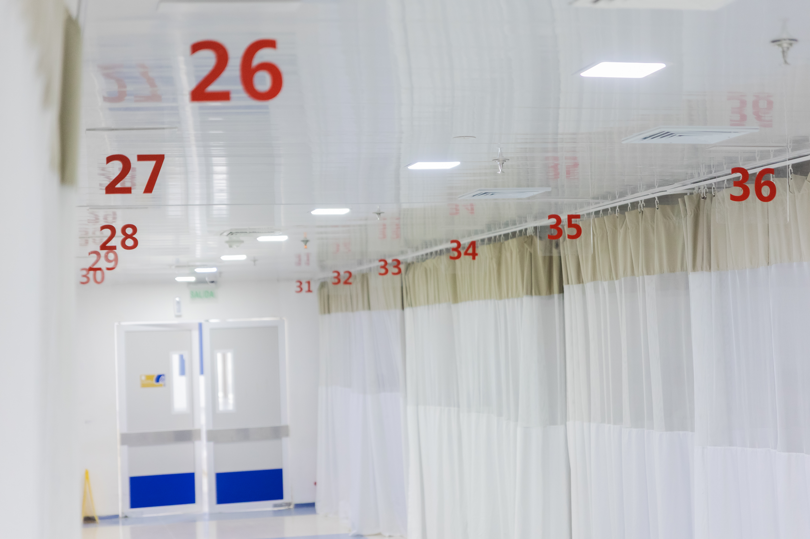

Urgencias

Cuidado crítico

Capacidad actual

## 123

Camas habilitadas

Nueva torre

### 7.764 m2

Proyección

## 218

Camas proyectadas

[Botón: Volver a servicios](https://clinicalaesperanza.co/portafolio/)

[Botón: Hospitalización](https://clinicalaesperanza.co/p-hospitalizacion/)

[Botón: Pedriatría](https://clinicalaesperanza.co/p-pediatria/)

[Botón: Suite VIP](https://clinicalaesperanza.co/p-suite-vip/)

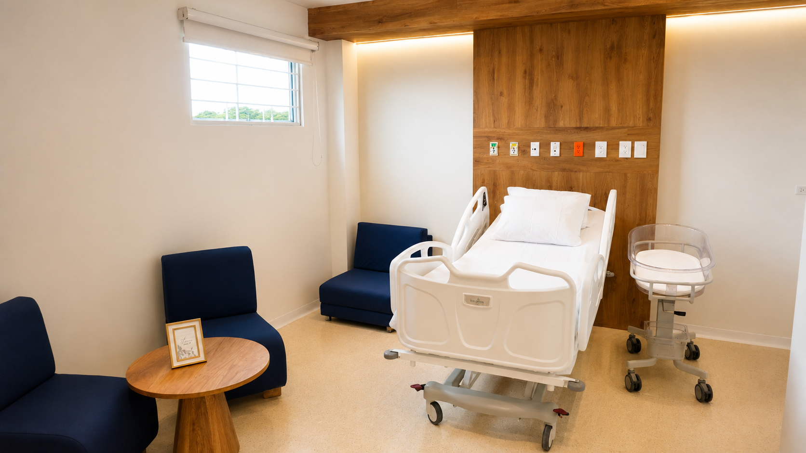

#### URGENCIAS

# Atención de Urgencias 24 horas

#### Nuestra gestión se orienta al mejoramiento continuo, la innovación y el fortalecimiento de las capacidades institucionales, consolidando una oferta de servicios que responde a los desafíos actuales del sector salud.

#### URGENCIAS

# Atención de Urgencias 24 horas

#### URGENCIAS

# Atención de Urgencias 24 horas

#### Capacidad instalada

#### URGENCIAS

# Atención de Urgencias 24 horas

Johan Cruz Martinez

Cirugía de alta complejidad en la que se retiró el quiste de la vía biliar y se reconstruyó el paso de la bilis.

#### URGENCIAS

# Atención de Urgencias 24 horas

Johan Cruz Martinez

Cirugía de alta complejidad en la que se retiró el quiste de la vía biliar y se reconstruyó el paso de la bilis.

Servicio

Camas actuales

Ampliación

Proyección total

Hospitalización General

26

38

64

Hospitalización Cuarto Piso

32

64

Cuidados Intensivos Adultos

12

19

Cuidados Intermedios Adultos

2

11

13

Cuidados Intensivos Neonatal

26

4

30

Cuidados Intensivos Pediátricos

7

8

15

Total

105

101

205

#### URGENCIAS

# Atención de Urgencias 24 horas

[Botón: Pedriatría](https://clinicalaesperanza.co/p-pediatria/)

#### Nuestra gestión se orienta al mejoramiento continuo, la innovación y el fortalecimiento de las capacidades institucionales, consolidando una oferta de servicios que responde a los desafíos actuales del sector salud.

Johan Cruz Martinez

Cirugía de alta complejidad en la que se retiró el quiste de la vía biliar y se reconstruyó el paso de la bilis.

[Botón: Conoce más](https://clinicalaesperanza.co/p-detalle-suite-serena/)

Cirugía de columna

Intervención quirúrgica especializada para corregir la causa del dolor crónico.

Parto humanizado

Experiencia de nacimiento respetuosa, segura y acompañada.

#### ESPECIALIDADES MÉDICAS

Pediatría

Incluye

Monitoreo fetal antes y durante el parto, ejercicios para el trabajo de parto, bloqueo epidural disponible, acompañamiento de un familiar durante el nacimiento, alojamiento en Suite VIP por 2 días, menú a elección con merienda, kit de aseo personal, valoración del recién nacido por pediatra neonatólogo, tamizaje de enfermedades metabólicas neonatales, toma de muestra para banco de células madre, control con ginecología, control pediátrico.
