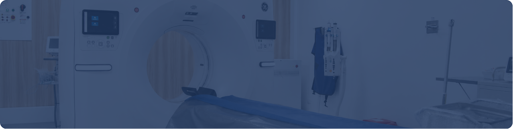
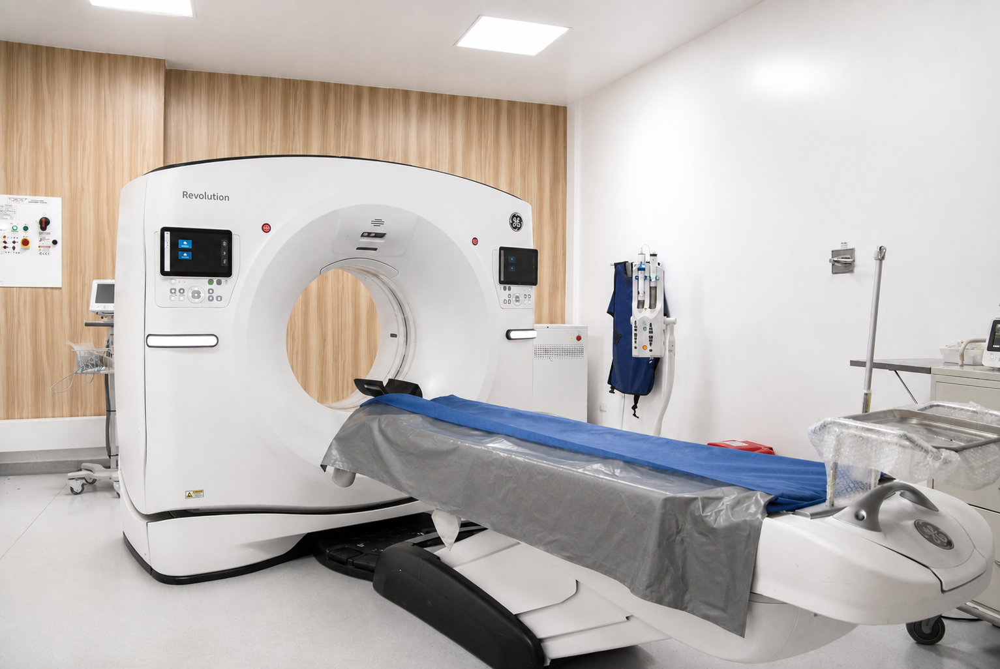
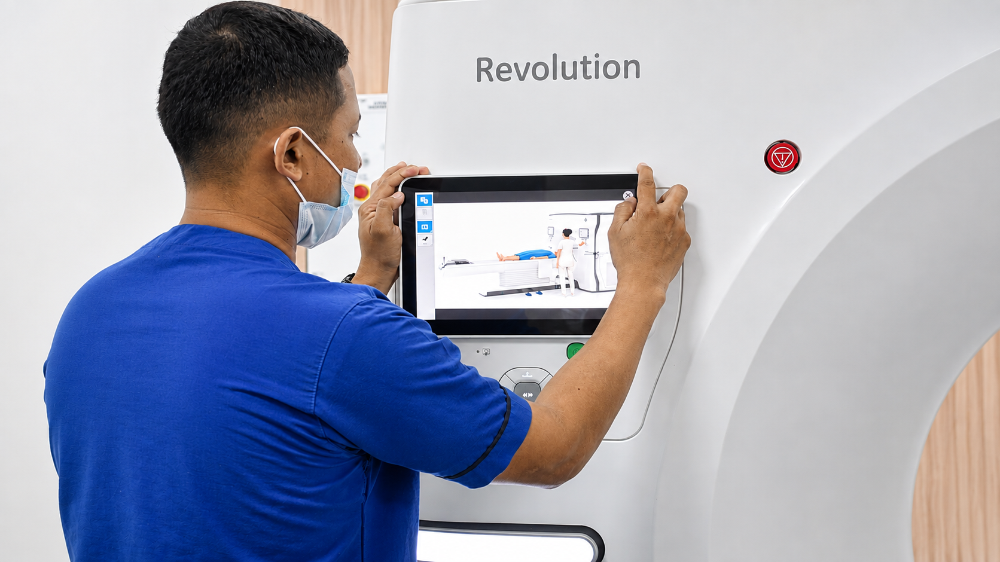
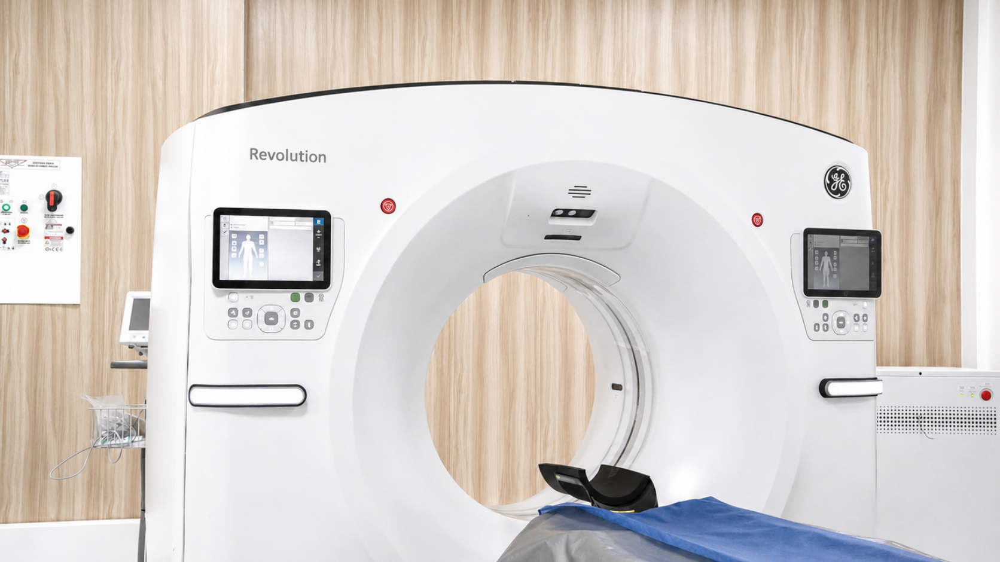

[Botón: Inicio](https://clinicalaesperanza.co/portafolio/)

[Botón: Volver a servicios](https://clinicalaesperanza.co/portafolio/)

## Diagnóstico y Apoyo Terapéutico

Equipos de alta tecnología para un diagnóstico oportuno.

Este servicio está diseñado para respaldar de manera integral los procesos clínicos y asistenciales, facilitando un abordaje oportuno, preciso y seguro del estado de salud del paciente.

#### Tecnología que marca la diferencia

Contamos con un tomógrafo General Electric Revolution™ Ascend, el primer equipo en Latinoamérica en incorporar un servidor con inteligencia artificial, que optimiza la calidad de los estudios y reduce significativamente la dosis de radiación.

Reconstrucción con IA (TrueFidelity™ DL) · Posicionamiento automático · Hasta 128 cortes

#### ¿Qué encontrarás en nuestro servicio de Diagnóstico y Apoyo Terapéutico?

## Imágenes diagnósticas ionizantes

- Tomografía

- Arco en C

- Rayos X fijo

- Rayos X portátil

## Imágenes diagnósticas no ionizantes

- Ecografía

- Diagnóstico cardiovascular

- Ultrasonido

## Apoyo terapéutico

- Laboratorio clínico

- Servicio farmacéutico

- Terapia respiratoria y física

- Gestión pretransfusiona

## Tomografía de nueva generación

Contamos con el tomógrafo General Electric Revolution™ Ascend, el primer equipo en Latinoamérica con inteligencia artificial integrada.

#### Menor dosis de radiación

#### La inteligencia artificial ayuda a obtener imágenes claras usando menos radiación, cuidando más al paciente.

#### Exámenes más rápidos​

#### La automatización del equipo reduce el tiempo que el paciente pasa en el estudio.​

#### Mayor comodidad​

#### El túnel del equipo es más ancho y la camilla más baja, lo que facilita el examen a pacientes de mayor tamaño o con lesiones que requieren manejo cuidadoso.

#### Diagnósticos más precisos

#### La inteligencia artificial ayuda a posicionar al paciente y ajustar el estudio automáticamente, reduciendo el margen de error.​

#### Diagnóstico preciso, respaldo terapéutico integral
