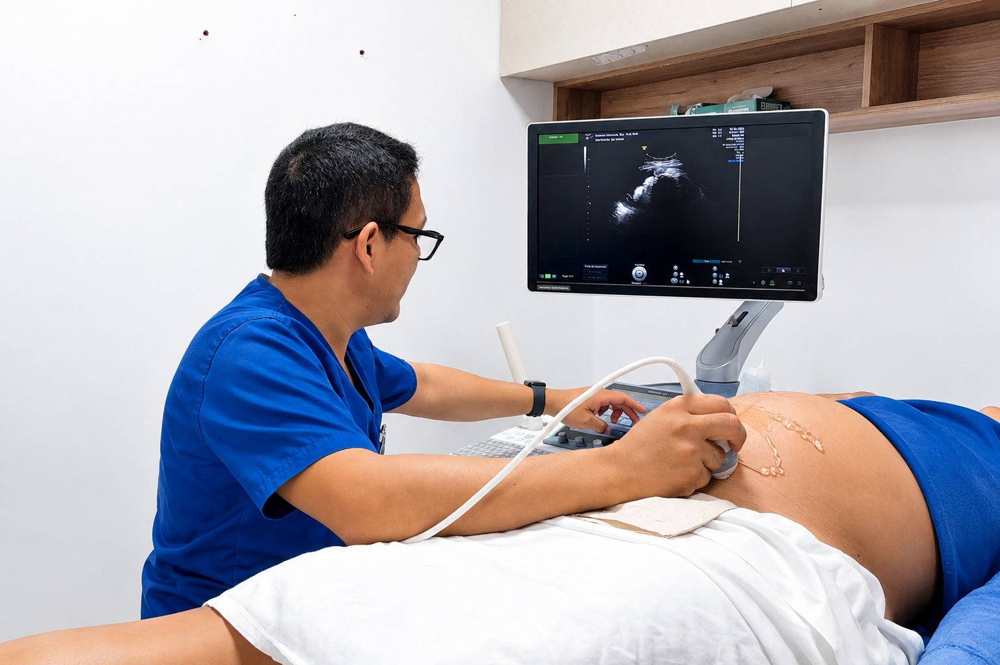
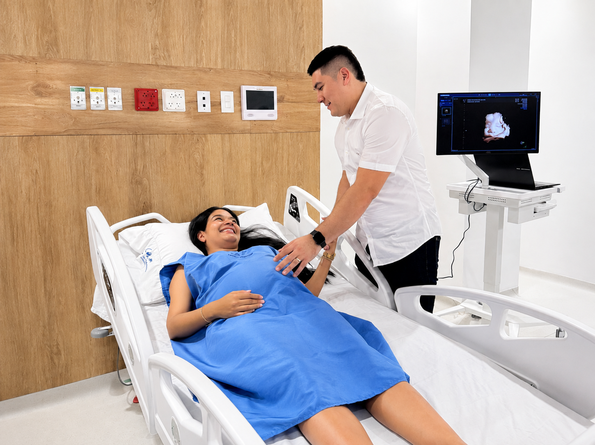
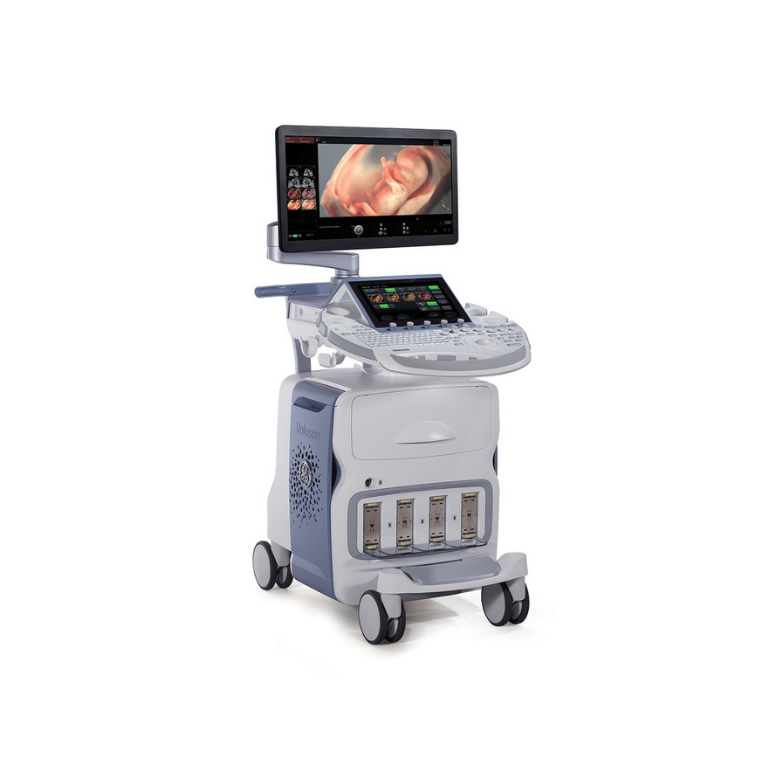
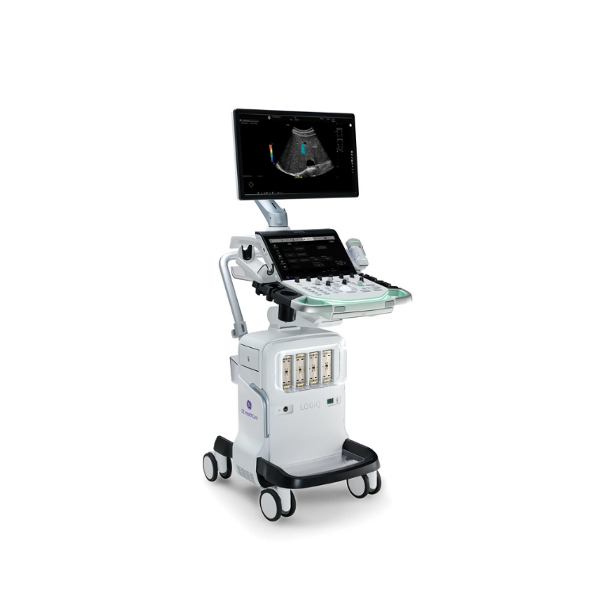
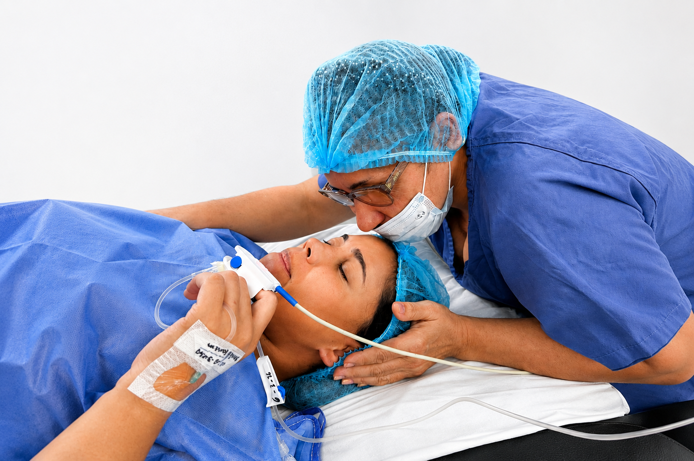
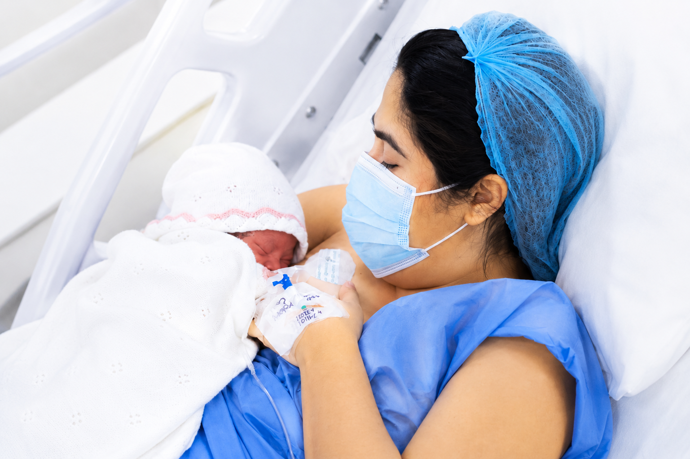
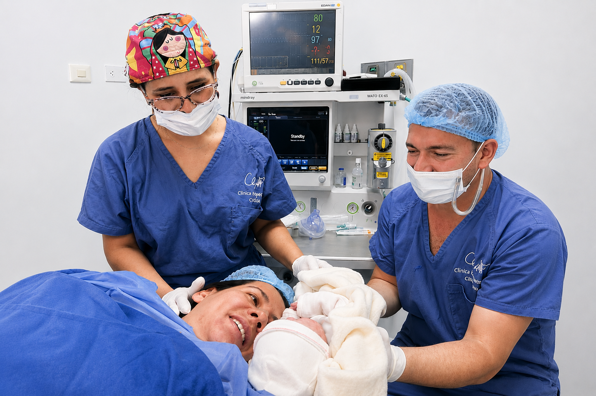
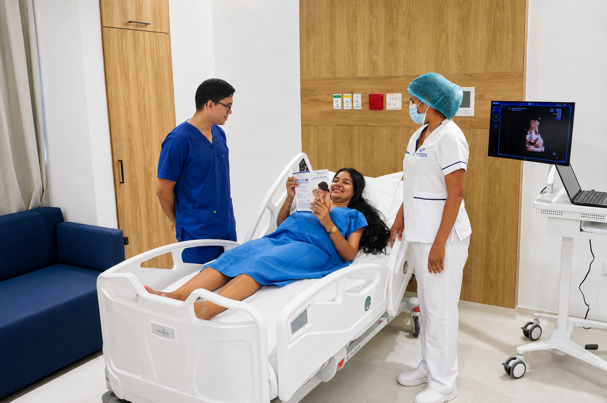

[Botón: Inicio](https://clinicalaesperanza.co/portafolio/)

[Botón: Volver a servicios](https://clinicalaesperanza.co/p-consulta-externa/)

## Ginecología y Obstetricia

Acompañamos a la mujer en cada etapa de su vida.

En Clínica La Esperanza acompañamos a la mujer con un enfoque profesional, respetuoso y humano, en cada etapa: desde el cuidado ginecológico hasta el embarazo, el parto y el postparto.

#### Obstetricia

Este servicio incluye controles prenatales regulares, monitoreo del crecimiento y desarrollo fetal, atención del parto ya sea natural o por cesárea y vigilancia posparto. Contamos con un equipo de especialistas en obstetricia, apoyado por personal de enfermería, neonatología, anestesiología y otras disciplinas, garantizando un entorno seguro, humano y altamente profesional.

#### Cuidado prenatal

Monitoreo de la salud materno-fetal.

#### Parto y asistencia en el nacimiento

Opciones de parto natural y cesárea.

#### Postparto

Atención y asesoramiento para la madre y el recién nacido.

#### Ginecología

La atención ginecológica no solo se enfoca en tratar enfermedades, sino en acompañar y orientar a la mujer en cada etapa de su vida, promoviendo el bienestar físico, emocional y reproductivo con un enfoque profesional, respetuoso y humano.

## Ginecología materno fetal

## Cuidado integral durante el embarazo, con enfoque en la salud de madre e hijo.

## Ginecología oncológica

## Prevención y tratamiento de cánceres ginecológicos, protegiendo la salud de nuestras pacientes.

## Ginecología laparoscópica

## Procedimientos mínimamente invasivos que aseguran una recuperación más rápida.

Voluson

Ecógrafo de perinatología

Permite ver con mayor claridad el desarrollo del bebé durante el embarazo, ayudando a una detección temprana y a un seguimiento más seguro, especialmente en embarazos de alto riesgo.

Logiq Totus

Equipo con elastografía

Permite evaluar el estado de los tejidos con mayor precisión, apoyando diagnósticos más certeros sin necesidad de procedimientos invasivos.

# Parto humanizado

Acompañamos a cada madre en un proceso respetuoso y cercano, honrando su ritmo y sus decisiones, con todo el respaldo clínico disponible si se necesita.

[Botón: Conoce más](https://clinicalaesperanza.co/p-nace-con-esperanza/)

#### Conoce nuestro servicio de Ginecología y Obstetricia

# Acompañando a la mujer en cada etapa de su vida

Ginecología y Obstetricia · Clínica La Esperanza · Montería
