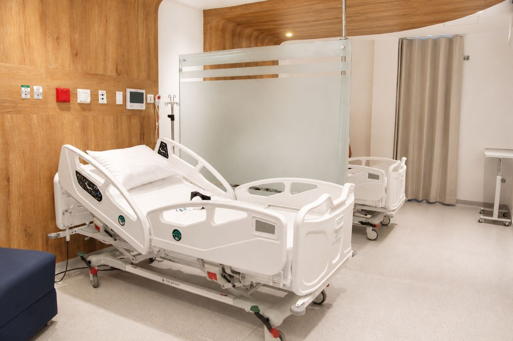

[Botón: Inicio](https://clinicalaesperanza.co/portafolio/)

[Botón: Volver a servicios](https://clinicalaesperanza.co/portafolio/)

[Botón: Hospitalización](https://clinicalaesperanza.co/p-hospitalizacion/)

[Botón: Hospitalización pediátrica](https://clinicalaesperanza.co/p-pediatria/)

[Botón: Suite VIP](https://clinicalaesperanza.co/p-suite-vip/)

## Hospitalización general

Nuestra hospitalización está diseñada para acompañarte durante cada etapa de tu recuperación, integrando espacios confortables, atención médica especializada y tecnología para el cuidado de nuestros pacientes.

#### Tu bienestar es nuestra prioridad

Cada espacio ha sido pensado para favorecer una recuperación confortable. Contamos con habitaciones cómodas, atención médica especializada y un equipo de enfermería disponible las 24 horas, garantizando un acompañamiento permanente durante toda la estancia hospitalaria.

#### Especialidades disponibles en Hospitalización

Durante tu hospitalización, diferentes profesionales pueden participar en tu proceso de atención según tus necesidades. La comunicación y el trabajo conjunto entre las distintas áreas nos permiten ofrecer un manejo integral y coordinado.

#### Medicina Interna

Neumología · Nefrología · Cardiología · Hemodinamia · Electrofisiología · Neurología · Gastroenterología · Hematología · Infectología

#### Ginecología

Materno Fetal (Perinatología) · Ginecología Oncológica · Ginecología Laparoscópica

#### Cirugía General

Cirugía Pancreatohepatobiliar · Cirugía de Tórax

#### Pediatría

Cardiología · Neumología · Infectología · Neonatología · Hemato-oncología · Endocrinología · Nefrología · Neurocirugía · Oftalmología · Gastroenterología y Cirugía pediátricas

#### Ortopedia y Traumatología

Ortopedia Oncológica · Artroscopia · Ortopedia Reconstructiva · Cirugía de Hombro · Revisión de Prótesis · Cirugía de Columna

#### Neurocirugía

Medicina del Dolor

#### Radiología

Radiología Intervencionista · Imágenes Cardíacas

#### Salud Mental

Psiquiatría · Psicología

#### Urología

#### Cirugía Cardiovascular

#### Cirugía Plástica

#### Cirugía Maxilofacial

#### Otorrinolaringología

#### Oftalmología y Oculoplastia

#### Fonoaudiología

#### Nutrición y Dietética

#### Fisioterapia

Rehabilitación Cardíaca · Terapia Física y Rehabilitación

#### UCI Adultos

Cuidados intensivos para pacientes adultos en estado crítico.

#### UCI Adultos

Cuidados intensivos para pacientes adultos en estado crítico.

#### UCI Adultos

Cuidados intensivos para pacientes adultos en estado crítico.

#### Un equipo que trabaja por tu recuperación

Durante tu hospitalización, diferentes profesionales pueden participar en tu proceso de atención según tus necesidades. La comunicación y el trabajo conjunto entre las distintas áreas nos permiten ofrecer un manejo integral y coordinado.

[Botón: Conoce nuestro equipo médico](#)

#### ¿Qué encontrarás durante tu hospitalización?

Atención médica especializada

Enfermería disponible las 24 horas

Habitaciones cómodas y climatizadas

Administración segura de medicamentos

Alimentación según indicación médica

Acompañamiento familiar

Seguimiento permanente del estado de salud

Espacios diseñados para brindar tranquilidad y bienestar

#### Conoce nuestros espacios

En Clínica La Esperanza creemos que sanar también significa sentirse acompañado, cómodo y seguro. Por eso ofrecemos espacios diseñados para brindar bienestar, tranquilidad y una atención humanizada durante cada etapa de la recuperación.

# Atención hospitalaria con calidad, seguridad y calidez humana

Espacios confortables y un equipo comprometido con tu recuperación y la tranquilidad de tu familia.

[Botón: Conoce más](#)
