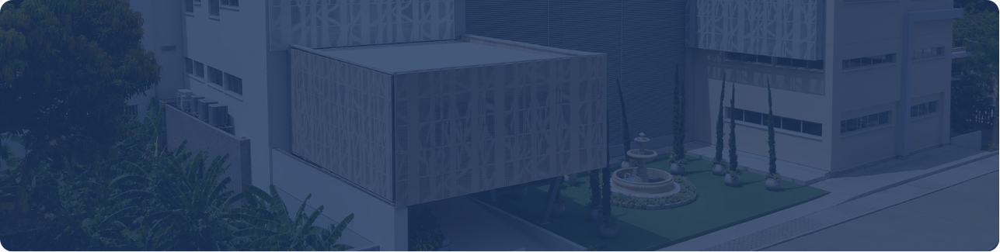
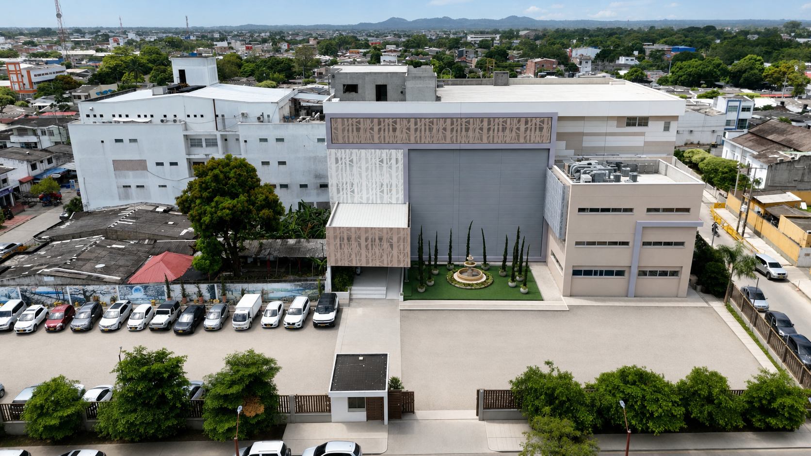
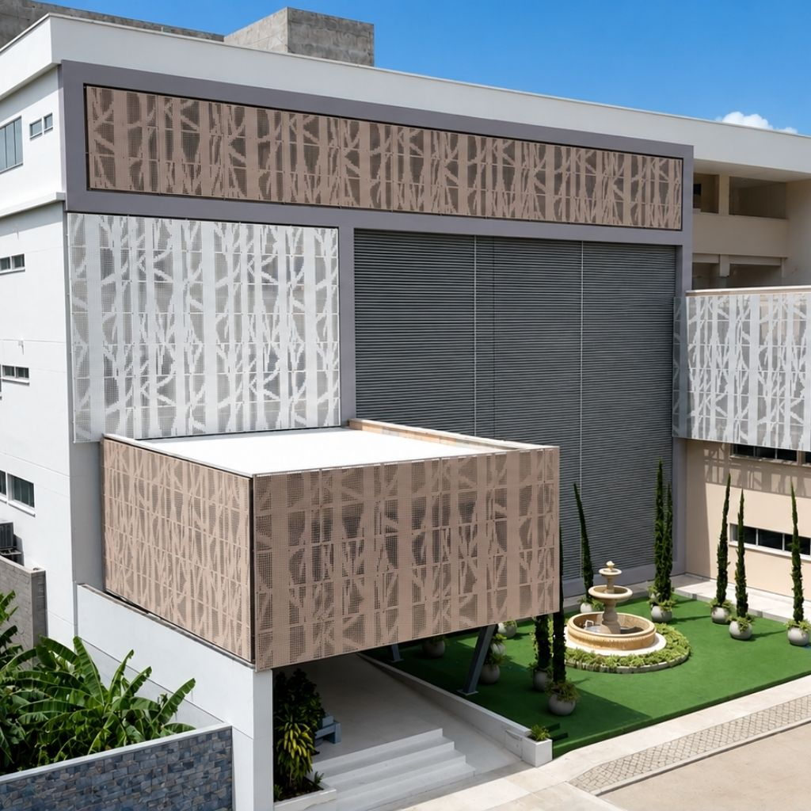
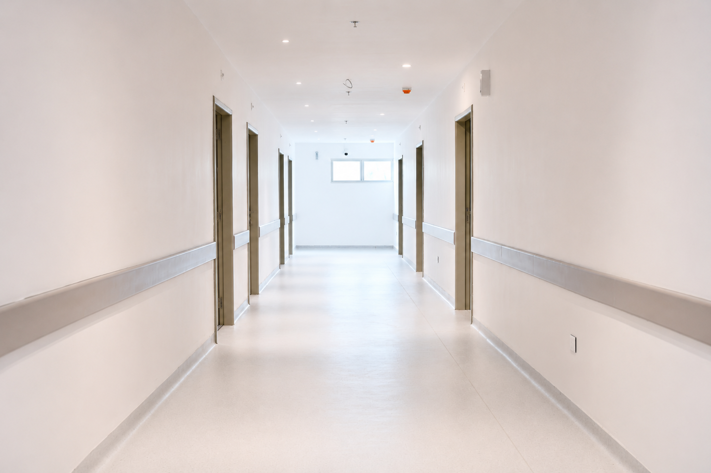
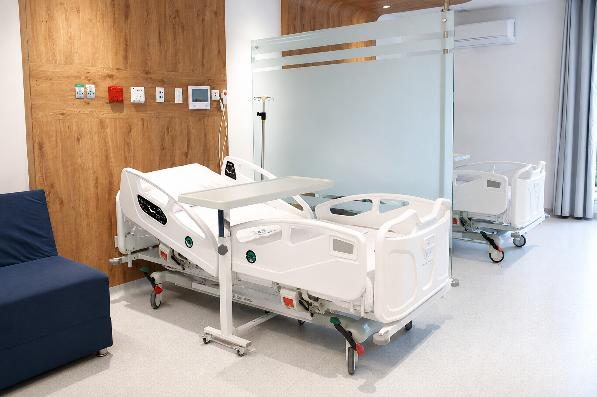
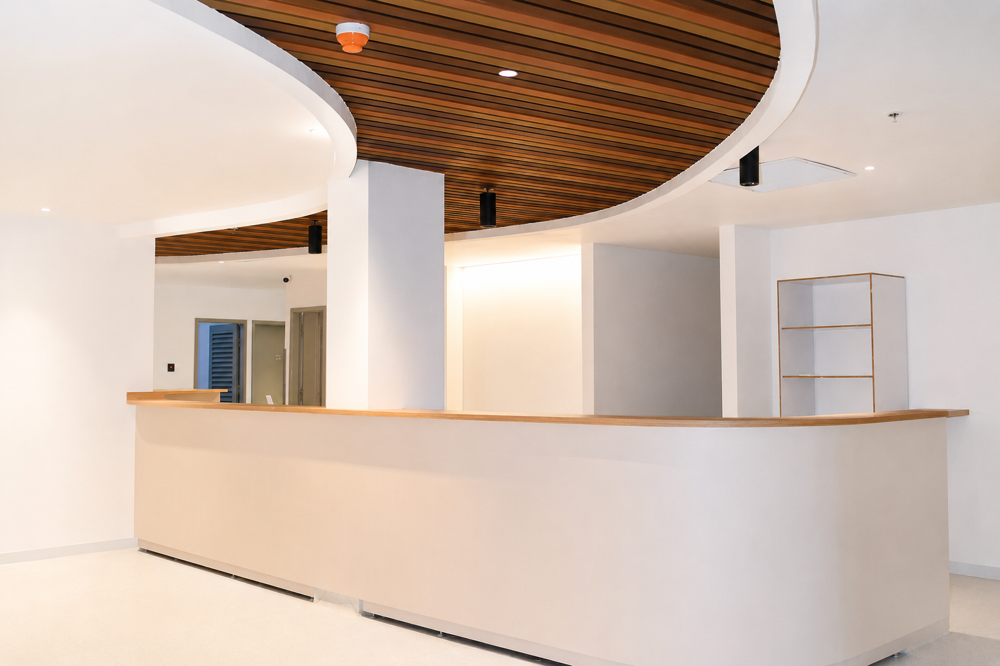
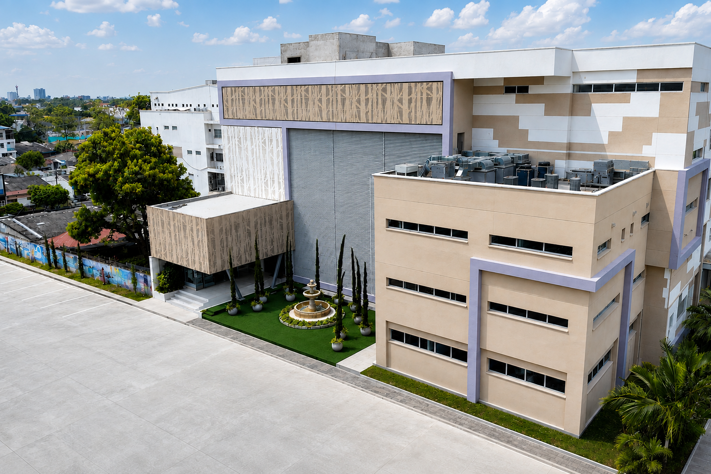

[Botón: Inicio](https://clinicalaesperanza.co/portafolio/)

[Botón: Volver a servicios](https://clinicalaesperanza.co/portafolio/)

Un proyecto de expansión que fortalecerá nuestra capacidad instalada y la atención para miles de familias.

# Construyendo el futuro de tu salud

#### EXPANSIÓN Y CRECIMIENTO

Capacidad actual

123 camas habilitadas

Nueva torre

7.764 m² de construcción

Proyección total

218 camas proyectadas

Las capacidades proyectadas estarán disponibles conforme avance el proceso de dotación, habilitación y puesta en operación de cada servicio.

#### Ampliación y proyección

Nuestra gestión se orienta al mejoramiento continuo, la innovación y el fortalecimiento de las capacidades institucionales, consolidando una oferta de servicios que responde a los desafíos actuales del sector salud.

Avanzamos en el fortalecimiento de nuestra infraestructura, tecnología y talento humano para ofrecer una atención más integral, segura y oportuna, con una visión de futuro y nuevas posibilidades para nuestros pacientes.

#### Galería del proyecto

#### Así crecerá nuestra capacidad

Servicio

Camas actuales

Ampliación

Proyección total

Hospitalización General

26

38

64

Hospitalización Cuarto Piso

32

64

Cuidados Intensivos Adultos

12

19

Cuidados Intermedios Adultos

2

11

13

Cuidados Intensivos Neonatal

26

4

30

Cuidados Intensivos Pediátricos

7

8

15

Total

105

101

205

#### Detalles del proyecto de ampliación

Edificio principal, ubicado sobre la calle 12. Área del lote: 737 m². Área construida: 3.496 m².

Pertenece al edificio ubicado sobre la carrera 7. Área del lote: 360 m². Área construida: 720 m². Área pendiente de construcción: 360 m².

Corresponde al edificio de la nueva construcción, ubicado sobre la calle 11. Área total: 7.764 m², distribuidos en Piso 1 (1.744,25 m² — habilitado), Piso 2 (1.744,25 m²), Piso 3 (1.744,25 m²), Piso 4 (1.266 m²), Piso 5 (1.266 m²).

Área sin construir — Lote para parqueadero: 1.988,5 m².

# Un futuro con más capacidad para cuidar de ti

Conoce más sobre nuestro compromiso de seguir creciendo para brindarte una mejor atención.
