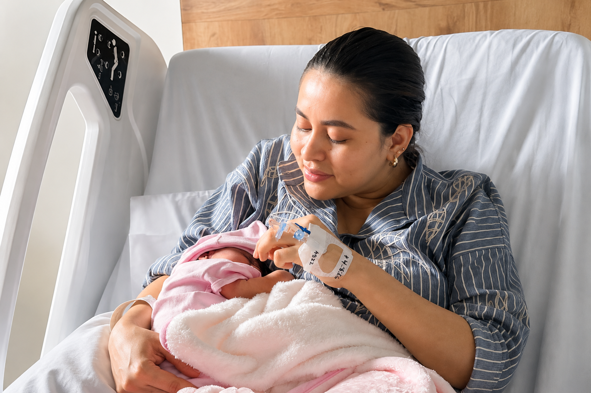

[Botón: Inicio](https://clinicalaesperanza.co/portafolio/)

[Botón: Volver a servicios](https://clinicalaesperanza.co/portafolio/)

## Nace con Esperanza

Acompañamos el nacimiento de tu bebé con una experiencia de atención, comodidad y cuidado en cada etapa, pensada para tu bienestar y el de tu recién nacido en un entorno seguro y privado.

#### El inicio de una nueva historia

El nacimiento de un hijo es uno de los momentos más importantes en la vida de una familia. Por eso, creamos una experiencia pensada para acompañarte antes, durante y después del nacimiento, con atención especializada, espacios diseñados para tu comodidad y un equipo dispuesto a cuidar cada detalle.

Una experiencia integral para que mamá y bebé vivan este momento con tranquilidad, confianza y bienestar.

#### ¿Por qué vivir esta experiencia en Clínica La Esperanza?

#### Atención especializada

#### Cuidado integral para mamá y bebé durante cada etapa del nacimiento.

#### Comodidad y bienestar​

#### Espacios diseñados para brindar privacidad y una experiencia tranquila.

#### Experiencia humanizada​

#### Acompañamiento y bienestar durante cada momento del nacimiento.

#### Esto es todo lo que vas a encontrar en nuestra experiencia

Realizamos seguimiento antes y durante el nacimiento para evaluar el bienestar de tu bebé, brindando monitoreo continuo y acompañamiento permanente con el especialista en ginecología, quien estará atenta a cada etapa del proceso para ofrecer mayor seguridad y tranquilidad.

Durante el trabajo de parto se realizan ejercicios guiados que ayudan a favorecer el bienestar de la madre, mejorar la movilidad y acompañar el proceso de manera más cómoda y controlada. Estos ejercicios están orientados a facilitar el desarrollo del parto y brindar mayor tranquilidad durante esta etapa.

Requisito: certificado del curso psicoprofiláctico o curso prenatal

Durante el nacimiento, un acompañante podrá estar presente para brindar apoyo a mamá durante este momento. Además, podrá participar en los primeros instantes de la llegada del bebé y compartir esta experiencia especial junto a la familia.

Alivio para mayor bienestar

Contamos con alternativas que ayudan a disminuir las molestias durante el nacimiento y el proceso de recuperación, brindando mayor comodidad y bienestar.

Parto vaginal: bloqueo epidural disponible durante el trabajo de parto.

Cesárea: bomba de manejo del dolor hasta por 72 horas para favorecer una recuperación más confortable.

Desde sus primeros momentos de vida, tu bebé contará con valoración y seguimiento especializado:

Valoración por pediatra: Evaluación especializada del recién nacido.

Tamizaje de enfermedades metabólicas neonatales: detección temprana de condiciones de salud.

Cita de control con pediatría: seguimiento a los 5 días del nacimiento.

Control con ginecología: seguimiento para evaluar la recuperación de mamá.

Alojamiento en Suite VIP por 2 días, menú a elección con merienda para la paciente, menú diferencial para el acompañante (costo adicional), kit de aseo personal, televisión, nevera, estación de café, espacio cómodo de descanso para el acompañante, ambiente diseñado para una mejor recuperación.

Protección y futuro

Ofrecemos la toma de sangre del cordón umbilical al momento del nacimiento, un procedimiento seguro que permite conservar células madre con posibles usos médicos en el futuro del bebé o su familia.

- Se realiza en el momento del nacimiento, sin interferir con el parto.

- Es seguro y realizado por personal capacitado.

- Permite conservar células en un banco especializado.

- Es una decisión única que solo puede tomarse al nacer.

#### Planes / Paquetes

#### Parto Humanizado

#### Una experiencia diseñada para acompañar el nacimiento de tu bebé de forma segura, respetuosa y con atención integral para mamá y recién nacido.

#### $ 6.000.000

Incluye

- Monitoreo fetal antes y durante el parto

- Ejercicios para el trabajo de parto

- Bloqueo epidural disponible

- Acompañamiento de un familiar

- Alojamiento en Suite VIP por 2 días

- Menú a elección con merienda

- Kit de aseo personal

- Valoración del recién nacido por pediatra neonatólogo

- Tamizaje de enfermedades metabólicas neonatales

- Contro con ginecología

- Control pediátrico

- Toma de muestra para el banco de células madres ( adicional)

#### Cesárea humanizada

#### Una experiencia enfocada en la seguridad, el bienestar y la comodidad durante el nacimiento por cesárea, con acompañamiento integral para mamá y bebé.

#### $ 7.000.000

Incluye

- Monitoreo fetal antes y durante el parto

- Bomba del dolor por hasta 72 horas

- Acompañamiento de un familiar

- Alojamiento en Suite VIP por 2 días

- Menú a elección con merienda

- Kit de aseo personal

- Valoración del recién nacido por pediatra neonatólogo

- Tamizaje de enfermedades metabólicas neonatales

- Contro con ginecología

- Control pediátrico

- Toma de muestra para el banco de células madres ( adicional)

# Comunícate con nosotros y vive esta experiencia

AppCLEM (App Store / Google Play) · Calle 12 # 4-58, Barrio Buenavista · PBX 7848903 · info@clinicalaesperanza.co
