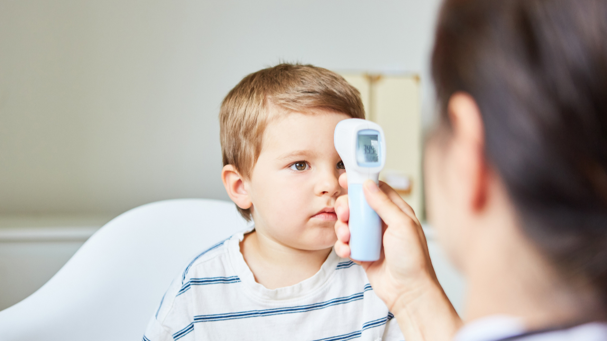

[Botón: Inicio](https://clinicalaesperanza.co/portafolio/)

[Botón: Volver a servicios](https://clinicalaesperanza.co/p-consulta-externa/)

En Clínica La Esperanza ofrecemos un servicio de Pediatría orientado a la prevención, el diagnóstico, el tratamiento y el seguimiento de la salud infantil, brindando una atención cercana, segura y humanizada.

## Pediatría

#### Consultorios cómodos y adecuados para la atención infantil

Nuestros consultorios brindan un ambiente cómodo, seguro y acogedor para que cada niño reciba una atención especializada en espacios diseñados para favorecer su bienestar y el de su familia.

Cardiología Pediátrica

Neumología pediátrica

Infectología pediátrica

Hemato-oncología pediátrica

Endocrinología pediátrica

Neurocirugía pediátrica

Oftalmología pediátrica

Cirugía pediátrica

#### UCI Adultos

# Cuidamos su salud desde el comienzo

Agenda una valoración pediátrica y acompaña cada etapa de su crecimiento con el respaldo de nuestros especialistas

[Botón: Conoce más](#)
