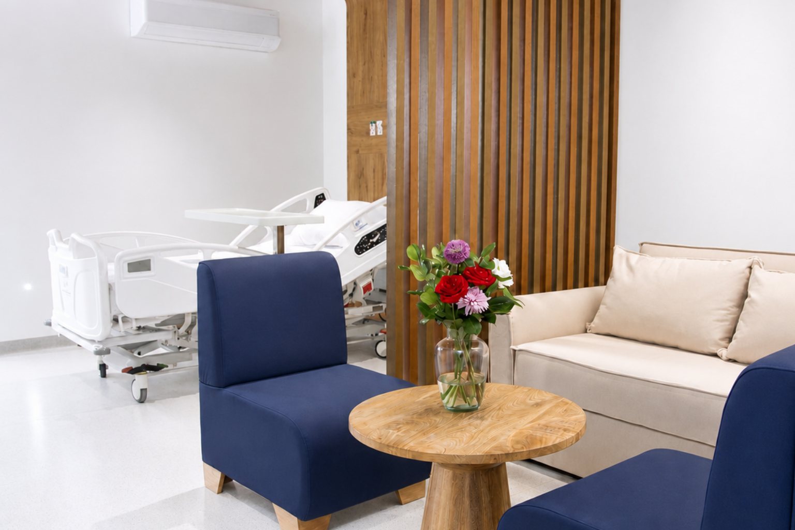
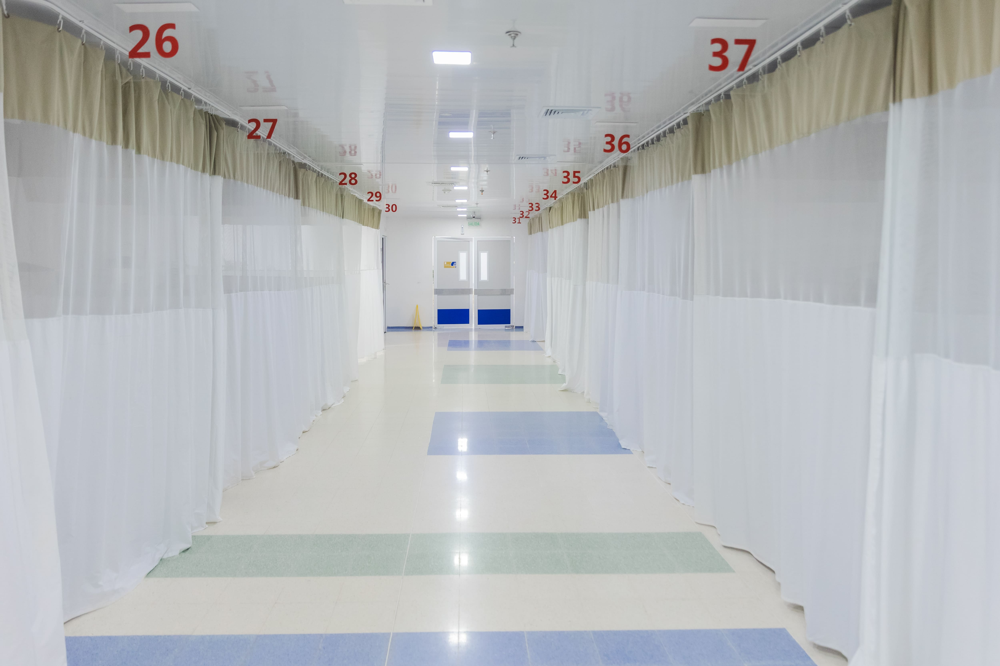
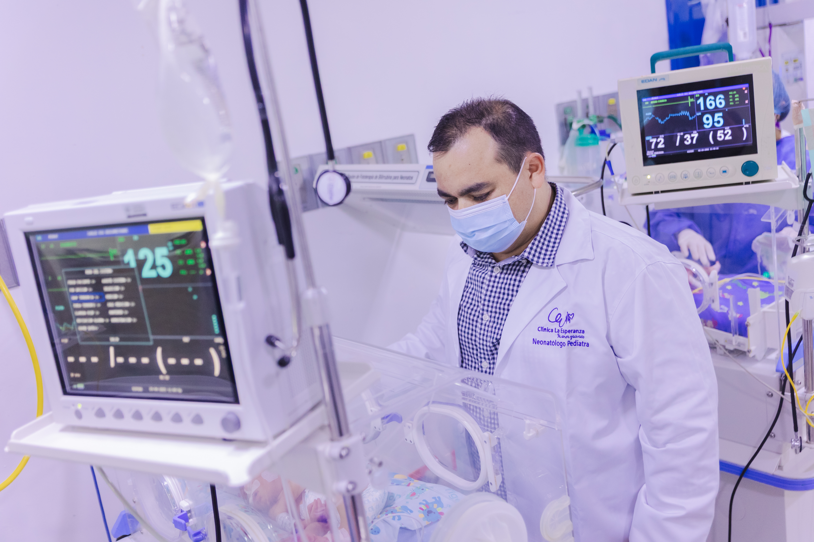
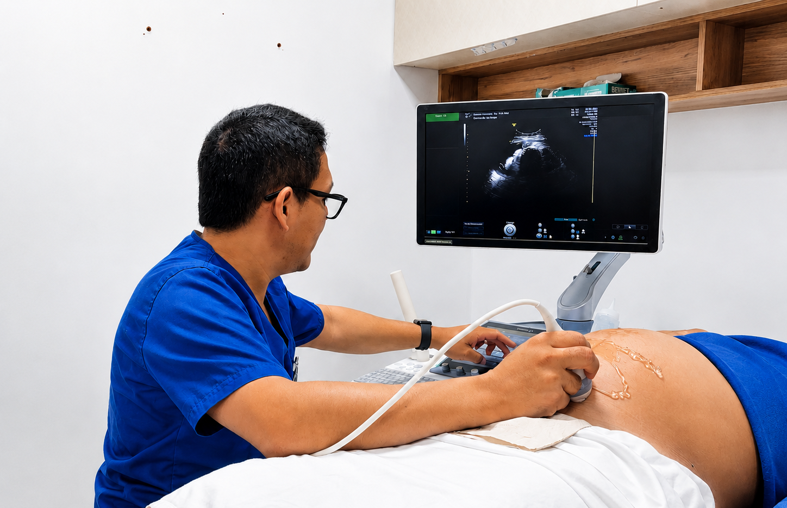
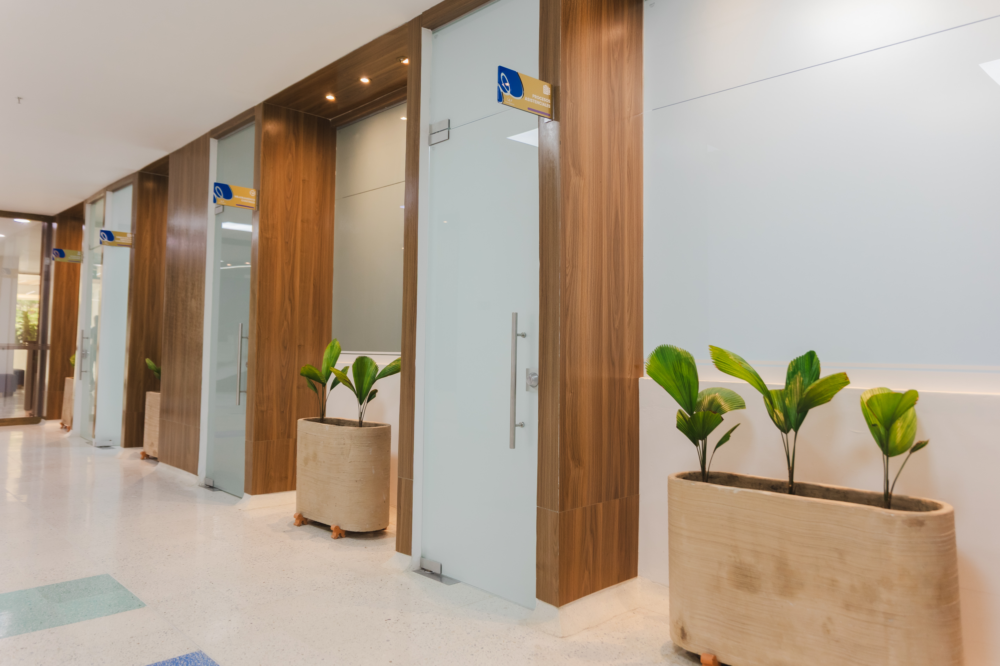
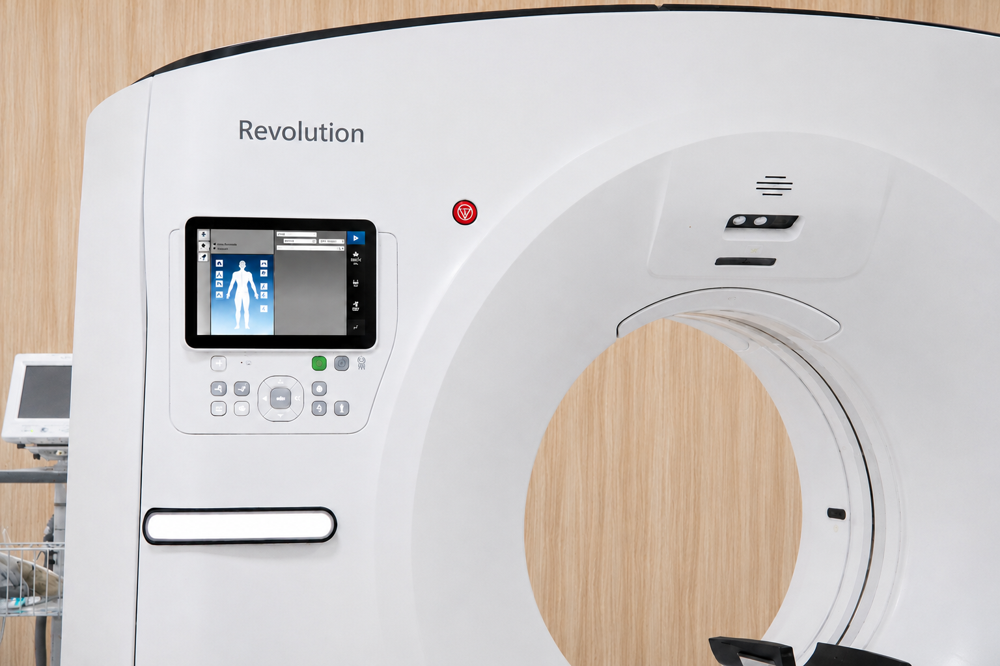
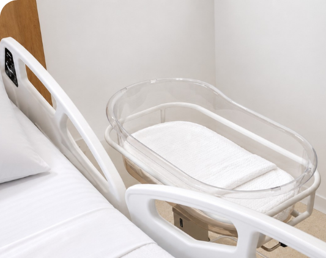
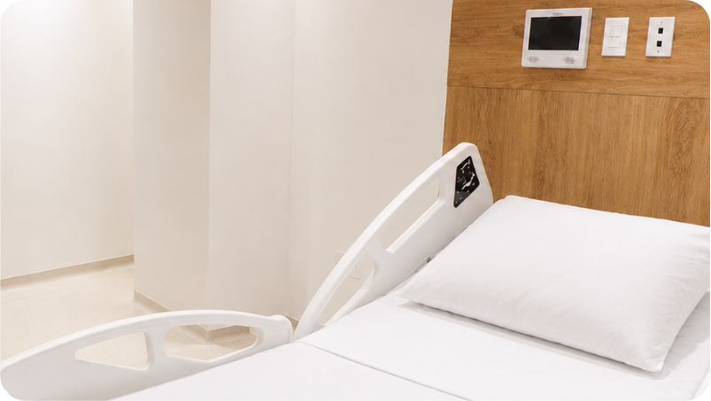

[Botón: Inicio](https://clinicalaesperanza.co/portafolio/)

[Botón: Volver a servicios](https://clinicalaesperanza.co/portafolio/)

[Botón: Hospitalización gold](https://clinicalaesperanza.co/p-hospitalizacion/)

[Botón: Hospitalización pediátrica](https://clinicalaesperanza.co/p-pediatria/)

[Botón: Suite VIP](https://clinicalaesperanza.co/p-suite-vip/)

## Hospitalización Pediátrica

Cuidamos de ti en cada etapa de tu recuperación.

En Clínica La Esperanza contamos con un área de Hospitalización Pediátrica diseñada para brindar una atención segura, cálida y especializada para los niños. Nuestro equipo médico y de enfermería acompaña a cada paciente y su familia durante todo el proceso de recuperación, ofreciendo un ambiente confortable, cercano y pensado para generar tranquilidad.

#### Atención coordinada

Especialidades que respaldan cada hospitalización

Durante la hospitalización pediátrica, diferentes especialidades pueden intervenir de acuerdo con las necesidades clínicas de cada paciente.

Cardiología pediátrica

Neumología pediátrica

Infectología pediátrica

Neonatología

Neurocirugía pediátrica

Oncología

Endocrinología

Nefrología

Oftalmología

Gastroenterología

Cirugía pediátrica

#### Conoce nuestros espacios

En Clínica La Esperanza creemos que sanar también significa sentirse acompañado, cómodo y seguro. Por eso ofrecemos espacios diseñados para brindar bienestar, tranquilidad y una atención humanizada durante cada etapa de la recuperación.

# Pequeños pacientes, grandes cuidados

Contamos con un entorno especializado para acompañar a los niños durante su estancia hospitalaria.

[Botón: Conoce más](#)
