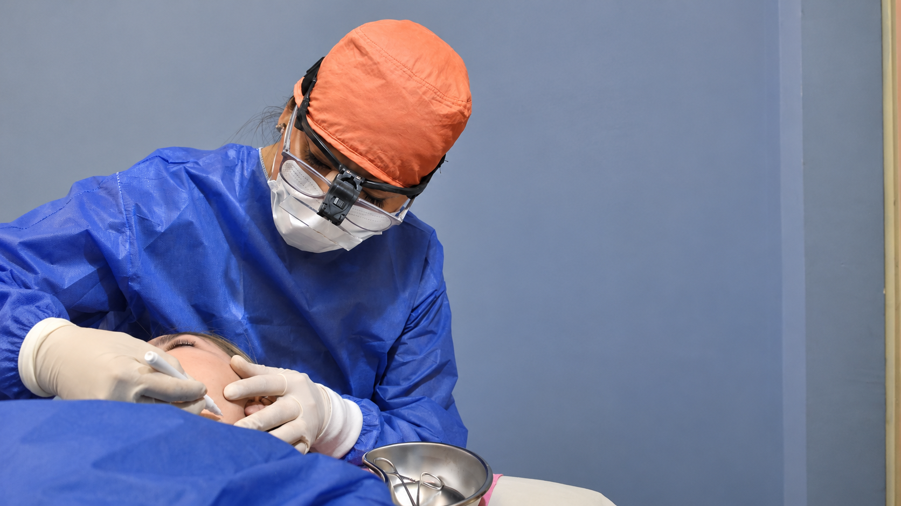

[Botón: Inicio](https://clinicalaesperanza.co/portafolio/)

[Botón: Volver a servicios](https://clinicalaesperanza.co/p-consulta-externa/)

## Cirugía Maxilofacial

Cuidado especializado de la cara, boca y maxilares.

Atención especializada para el diagnóstico y tratamiento de condiciones que afectan las estructuras faciales y maxilofaciales.

## Función y bienestar

La región maxilofacial reúne estructuras fundamentales para funciones como hablar, masticar y respirar. Nuestro servicio aborda alteraciones que pueden afectar su funcionamiento y apariencia, ofreciendo una valoración especializada para definir el tratamiento más adecuado.

#### Tratamientos especializados

#### Trauma facial

Atención de lesiones que afectan los huesos y tejidos de la cara.

#### Cirugía de mandíbula y maxilares

Manejo de alteraciones que comprometen la estructura y función de los maxilares.

#### Patología maxilofacial

Evaluación y tratamiento de lesiones y enfermedades de la región maxilofacial.

#### Cirugía de tejidos blandos

Tratamiento de alteraciones que afectan los tejidos de la región facial y oral.

# Tu salud también está en los detalles

Agenda una valoración con nuestro servicio de Cirugía Maxilofacial.

[Botón: Conoce más](#)
