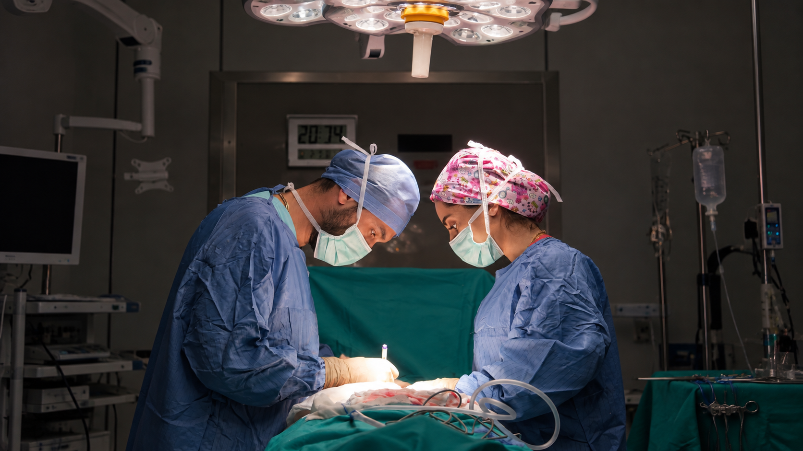
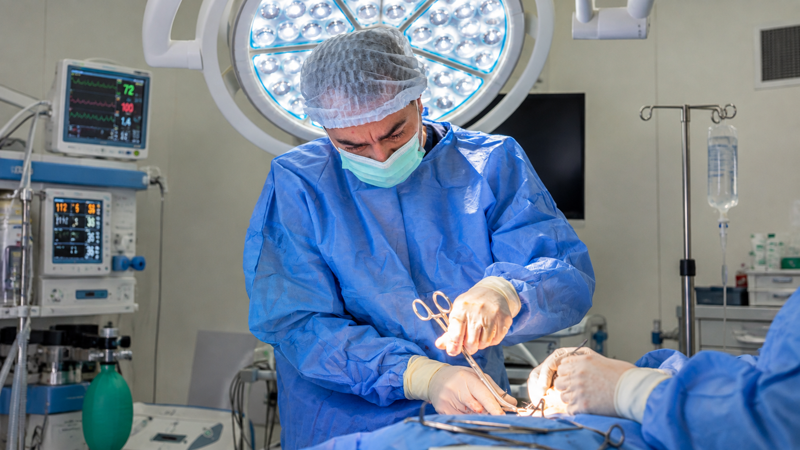

[Botón: Inicio](https://clinicalaesperanza.co/portafolio/)

[Botón: Volver a servicios](https://clinicalaesperanza.co/p-consulta-externa/)

## Cirugía Plástica

Atención especializada en procedimientos de cirugía plástica reconstructiva y estética, de acuerdo con las necesidades de cada paciente.

## Una cirugía con diferentes propósitos

##### Reconstrucción y estética

La cirugía plástica puede tener como objetivo recuperar la función y apariencia de una zona del cuerpo después de una enfermedad, lesión o procedimiento, así como realizar cambios estéticos.

## ¿Qué ofrecemos?

Cirugía estética

## Atención quirúrgica especializada

Nuestros procedimientos se desarrollan dentro de un entorno hospitalario, con el respaldo de profesionales y servicios necesarios para acompañar al paciente durante su proceso quirúrgico.

# Da el primer paso hacia tu objetivo

Agenda una valoración con nuestro servicio de Cirugía Plástica.

[Botón: Conoce más](#)
