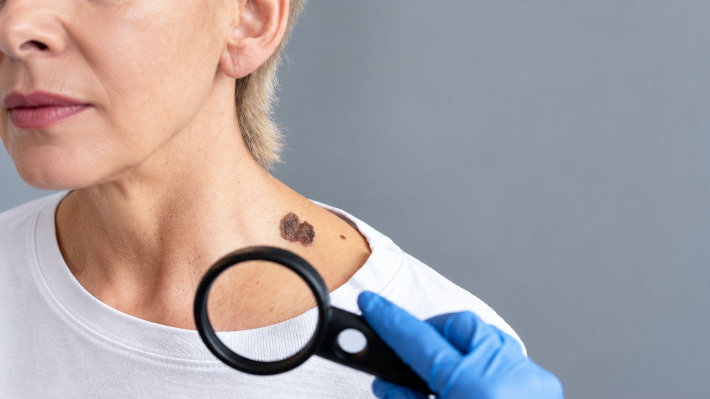

[Botón: Inicio](https://clinicalaesperanza.co/portafolio/)

[Botón: Volver a servicios](https://clinicalaesperanza.co/p-consulta-externa/)

## Dermatología

Prevención, diagnóstico y tratamiento de las enfermedades de la piel, el cabello y las uñas con una atención cercana y personalizada.

## Tu piel también merece atención integral

Evaluamos cada caso para ofrecer un diagnóstico claro y un plan de cuidado adaptado a tus necesidades.

## Atención dermatológica

#### Acné y marcas en la piel

#### Dermatitis y alergias

#### Infecciones de la piel

#### Lunares y lesiones cutáneas

#### Caída del cabello

#### Cuidado preventivo de la piel

## Diagnóstico oportuno

Una valoración especializada permite identificar cambios en la piel y orientar el tratamiento más adecuado.

## Cuidar tu piel es cuidar tu bienestar

Te acompañamos con recomendaciones claras para proteger y mantener la salud de tu piel en cada etapa.

## Dermatología en cada etapa de la vida

#### Infancia

Atención a las necesidades de la piel infantil.

#### Adultez

Prevención y tratamiento para una piel saludable.

#### Madurez

Seguimiento de cambios y cuidado integral.

# Agenda tu valoración de Dermatología

Estamos aquí para ayudarte a cuidar tu piel.

[Botón: Conoce más](#)
