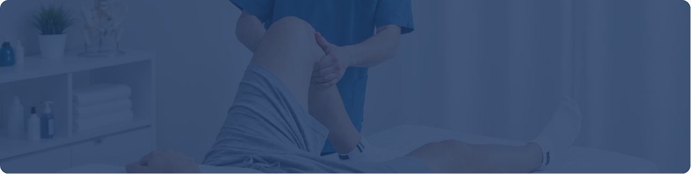
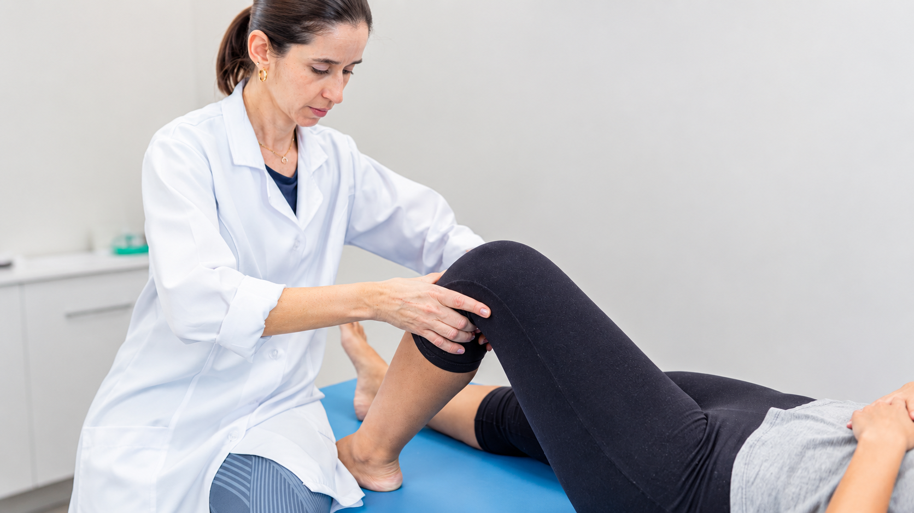

[Botón: Inicio](https://clinicalaesperanza.co/portafolio/)

[Botón: Volver a servicios](https://clinicalaesperanza.co/p-consulta-externa/)

## Fisioterapia

Recupera el movimiento, recupera tu bienestar.

Atención especializada para recuperar, mantener y mejorar la movilidad y funcionalidad del cuerpo.

## Recuperación y movimiento

La fisioterapia acompaña la recuperación de personas con lesiones, dolor, limitaciones de movimiento o alteraciones funcionales, mediante estrategias adaptadas a las necesidades de cada paciente.

#### Nuestros servicios

Rehabilitación Cardíaca

Programa de recuperación y acondicionamiento físico para personas con enfermedades cardiovasculares o después de procedimientos cardíacos, orientado a mejorar la capacidad funcional y favorecer una recuperación segura.

Terapia física y rehabilitación

Intervenciones dirigidas a recuperar el movimiento, la fuerza y la funcionalidad después de lesiones, enfermedades, cirugías o condiciones que limitan la movilidad.

## Movimiento y funcionalidad

##### Cada movimiento cuenta.

Trabajamos sobre las capacidades que necesitas recuperar para avanzar hacia una mayor independencia y funcionalidad.

#### Un proceso adaptado a ti

#### Evaluamos

Identificamos tus necesidades y limitaciones funcionales.

#### Trabajamos

Aplicamos técnicas y ejercicios de acuerdo con tus objetivos.

#### Evolucionamos

Ajustamos el proceso según tu respuesta y progreso.

# Recupera tu movimiento

Agenda tu valoración con nuestro servicio de Fisioterapia.

[Botón: Conoce más](#)
