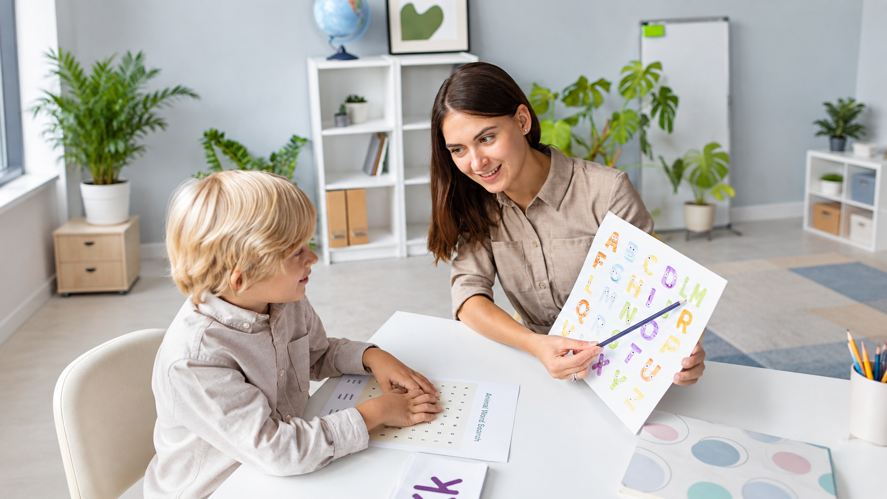

[Botón: Inicio](https://clinicalaesperanza.co/portafolio/)

[Botón: Volver a servicios](https://clinicalaesperanza.co/p-consulta-externa/)

## Fonoadiología

Atención especializada para evaluar, tratar y acompañar dificultades relacionadas con la comunicación, el lenguaje, el habla, la voz, la audición y la deglución.

#### Comunicar también es parte de nuestro bienestar

Hablar, comprender, expresarnos, escuchar y alimentarnos son actividades fundamentales para nuestra vida diaria. La Fonoaudiología interviene cuando alguna de estas funciones presenta dificultades, buscando favorecer la autonomía y participación de cada persona.

#### ¿Qué encontrarás en nuestro servicio?

#### Comunicación y lenguaje

Desarrollo y rehabilitación de habilidades de comunicación, comprensión y expresión.

#### Habla y voz

Evaluación e intervención de dificultades relacionadas con la articulación, fluidez y calidad de la voz.

#### Deglución y alimentación

Un espacio cómodo, seguro y funcional para una recuperación tranquila, con baño privado.

## Fonoaudiología en diferentes etapas

## Acompañamiento a lo largo de la vida

Las necesidades de comunicación y deglución cambian según cada etapa. Por eso, la atención se adapta a las características y objetivos de cada paciente.

Infancia

Adultez

## Un servicio que va más allá de hablar

## Cada función cuenta

La comunicación y la deglución están relacionadas con nuestra independencia, nuestras relaciones y nuestras actividades cotidianas. Nuestro objetivo es trabajar sobre las habilidades que cada persona necesita recuperar, desarrollar o mantener.

#### Mayor autonomía

Favorecer la participación en las actividades cotidianas.

#### Comunicación efectiva

Fortalecer las habilidades necesarias para expresarse y comprender.

#### Seguridad al alimentarse

Trabajar las dificultades relacionadas con la deglución.

#### Atención personalizada

Adaptar el proceso a las necesidades de cada paciente.

# Agenda tu valoración de Fonoaudiología

Da el primer paso hacia una comunicación y funcionalidad más seguras.

[Botón: Conoce más](#)
