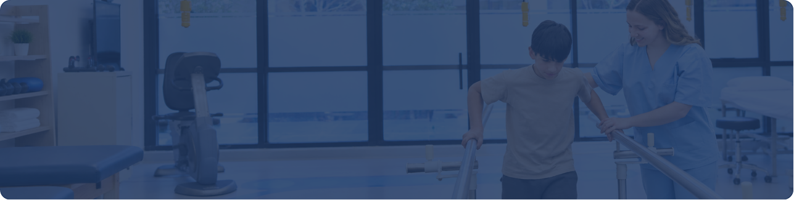
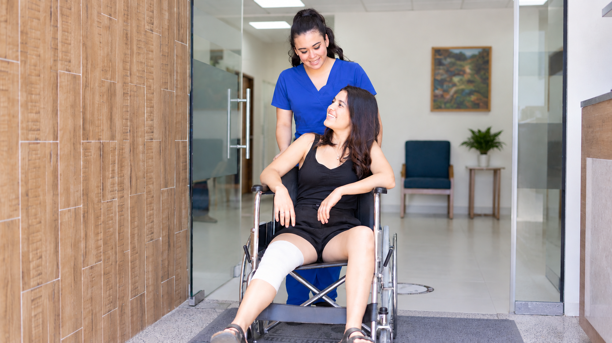
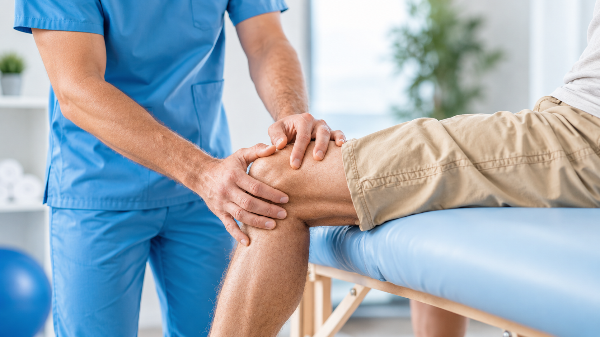
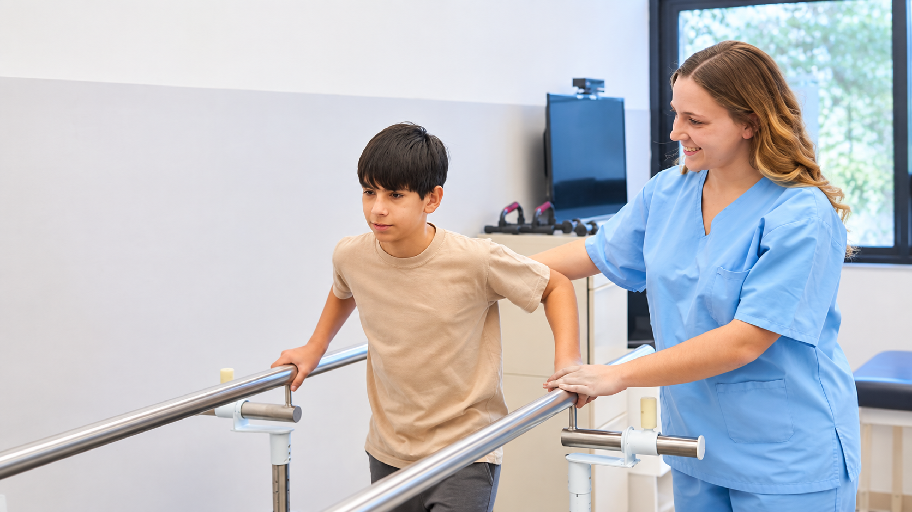

[Botón: Inicio](https://clinicalaesperanza.co/portafolio/)

[Botón: Volver a servicios](https://clinicalaesperanza.co/p-consulta-externa/)

## Medicina Física y Rehabilitación

Atención especializada para recuperar la funcionalidad, mejorar la movilidad y favorecer la independencia en las actividades de la vida diaria.

## Una nueva forma de avanzar

##### Tu recuperación tiene su propio ritmo

Cada proceso de rehabilitación es diferente. Evaluamos tus capacidades y necesidades para establecer objetivos que se adapten a tu condición y a tu vida cotidiana.

## Cada avance cuenta.

## El movimiento como punto de partida

##### Moverte mejor también es vivir mejor.

Trabajamos para recuperar aquellas funciones que pueden verse afectadas por una enfermedad, lesión, cirugía o condición que limite tu movilidad.

## Rehabilitación que se adapta a ti

Evaluación

Conocemos tus capacidades y limitaciones.

Objetivos

Definimos hacia dónde quieres llegar.

Evolución

Adaptamos el proceso a tus avances.

# Empieza a recuperar tu movimiento

Agenda una valoración en Medicina Física y Rehabilitación.

[Botón: Conoce más](#)
