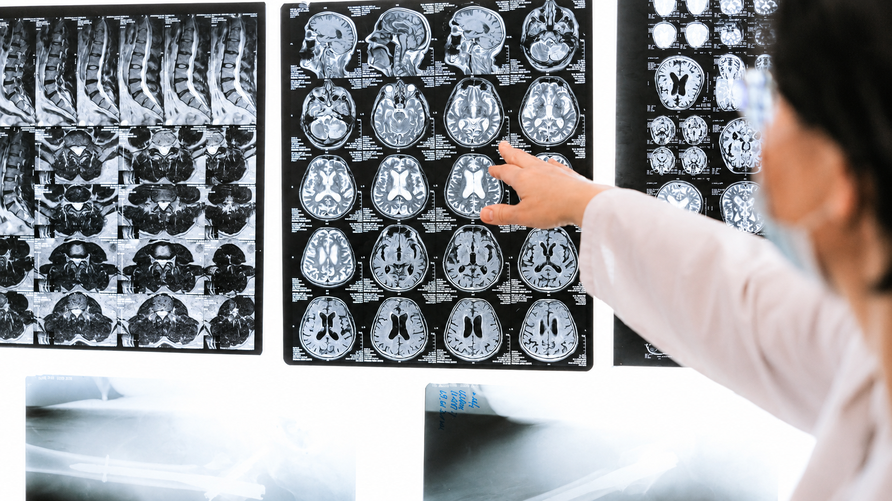

[Botón: Inicio](https://clinicalaesperanza.co/portafolio/)

[Botón: Volver a servicios](https://clinicalaesperanza.co/p-consulta-externa/)

## Neurología

Cuidamos la salud de tu sistema nervioso.

## El sistema nervioso está en todo lo que hacemos

El sistema nervioso participa en funciones esenciales como el movimiento, la memoria, el lenguaje, el quilibrio y la sensibilidad. Una valoración neurológica permite identificar alteraciones y orientar el manejo adecuado para cada paciente.

## Áreas de atención

Evaluamos alteraciones relacionadas con memoria, atención, lenguaje y otras funciones cognitivas.

Valoración de temblores, alteraciones cel movimiento, equilibrio y coordinación.

Atención a los cambios relacionados con la fuerza, sensibilidad y funcionamiento de los nervios.

## Cuando tu cuerpo envía señales

Dolores de cabeza recurrentes, cambios en la memoria, alteraciones del movimiento, pérdida de sensibilidad o problemas de equilibrio pueden ser señales que requieren una valoración especializada.

## Evaluación neurológica

##### Conocer lo que esta ocurriendo

La valoración neurológica comienza con una historia clínica detallada y una exploración especializada. Según cada caso, el profesional puede determinar si son necesarios estudios complementarios para orientar el diagnóstico y tratamiento.

# Cuidado especializado, en cada etapa de la vida

Cuidado Crítico · Clínica La Esperanza · Montería
