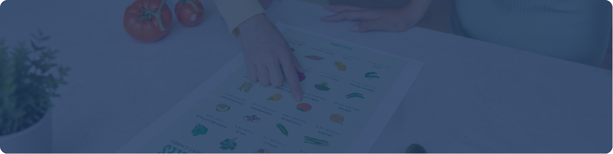
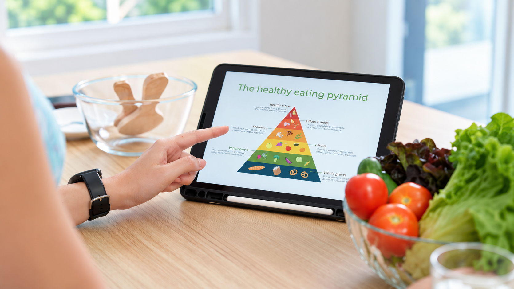

[Botón: Inicio](https://clinicalaesperanza.co/portafolio/)

[Botón: Volver a servicios](https://clinicalaesperanza.co/p-consulta-externa/)

## Nutrición y Dieta

Orientación nutricional para ayudarte a construir hábitos de alimentación adecuados a tus necesidades y objetivos.

## Alimentación y salud

Una alimentación adecuada debe tener en cuenta las necesidades de cada persona, sus hábitos, preferencias y condiciones particulares. Nuestro servicio de Nutrición y Dieta busca ayudarte a construir una relación más consciente y equilibrada con la alimentación.

#### Nuestros servicios

#### 01

#### Valoración nutricional

Evaluación de hábitos, alimentación y necesidades nutricionales para establecer objetivos personalizados.

#### 02

#### Planificación alimentaria

Orientación para organizar una alimentación equilibrada de acuerdo con las necesidades y objetivos de cada persona.

#### 03

#### Seguimiento nutricional

Acompañamiento para evaluar avances y realizar ajustes durante el proceso.

## Nutrición para diferentes necesidades

La alimentación puede desempeñar un papel importante en diferentes etapas de la vida y situaciones de salud. Por eso, el acompañamiento nutricional debe adaptarse a las características y objetivos de cada paciente.

#### Niños y adolescentes

#### Adultos

# Empieza a cuidar tu alimentación

Agenda una valoración con nuestro servicio de Nutrición y Dieta.

[Botón: Conoce más](#)
