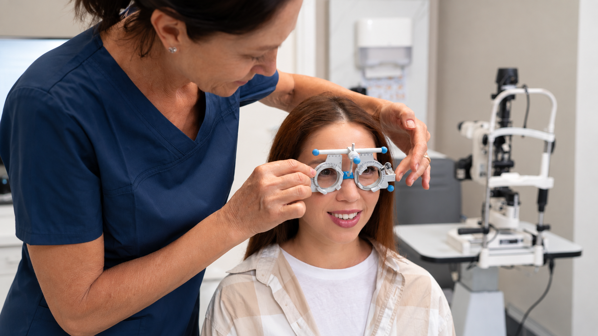
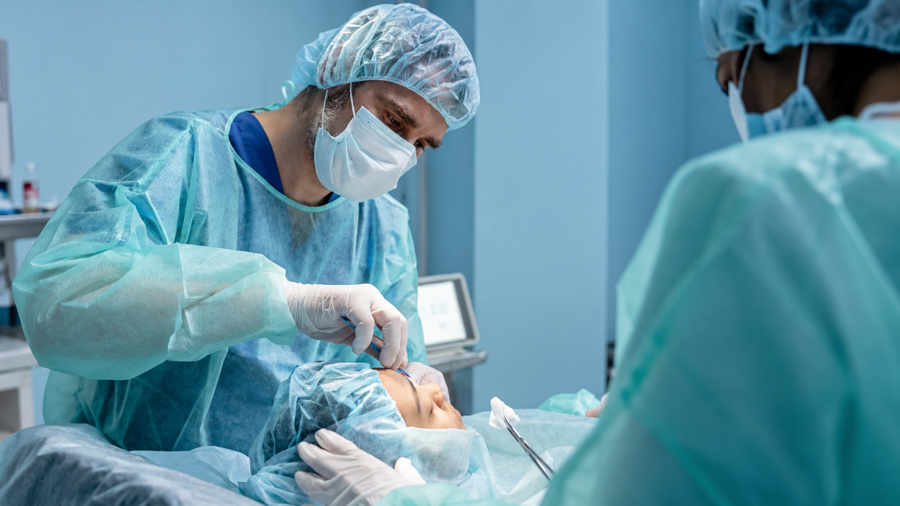

[Botón: Inicio](https://clinicalaesperanza.co/portafolio/)

[Botón: Volver a servicios](https://clinicalaesperanza.co/p-consulta-externa/)

## Oftalmología y oculoplastia

Atención especializada para la prevención, diagnóstico y tratamiento de enfermedades y alteraciones de los ojos y las estructuras que los rodean.

Cuidamos tu visión y la salud de tus ojos.

## Ver bien es parte de vivir bien

La salud visual puede cambiar a lo largo de la vida. Nuestro servicio ofrece valoración especializada para identificar alteraciones de la visión y enfermedades oculares, así como condiciones que afectan los párpados y la región alrededor de los ojos.

## Atención especializada

#### Consulta oftalmológica

Valoración integral de la salud ocular y de la función visual.

#### Diagnóstico ocular

Evaluación de diferentes enfermedades y alteraciones que pueden afectar los ojos y la visión.

#### Oculoplastia

Atención especializada de los párpados, órbita y estructuras perioculares.

## Una mirada más completa

## Tecnología para cuidar tu visión

Los estudios oftalmológicos permiten evaluar diferentes estructuras del ojo y obtener información que ayuda al especialista a detectar, controlar y tratar alteraciones visuales.

#### Evaluación precisa

Información detallada sobre el estado de tus ojos.

#### Detección oportuna

Identificación de alteraciones que pueden afectar la visión.

#### Seguimiento

Control de la evolución de diferentes condiciones oculares.

#### Atención especializada

Valoración de acuerdo con las necesidades de cada paciente.

## Oculoplastia

## Cuidado especializado de la región periocular

La Oculoplastia se ocupa de las estructuras que rodean y protegen los ojos, incluyendo los párpados, la órbita y las vías lagrimales. Su manejo busca preservar tanto la función como las características de cada paciente.

##### Párpados · Órbita · Vías lagrimales · Región periocular

# Una visión saludable comienza con cuidarla.

Agenda tu valoración con nuestro servicio de Oftalmología y Oculoplastia.

[Botón: Conoce más](#)
