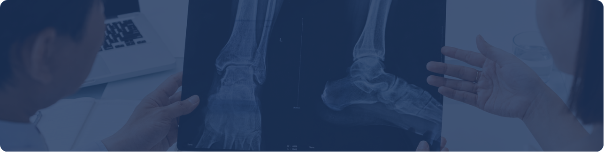
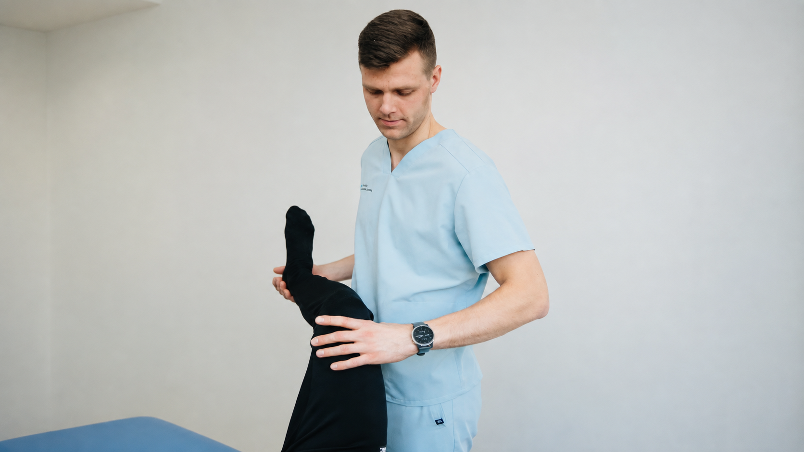

[Botón: Inicio](https://clinicalaesperanza.co/portafolio/)

[Botón: Volver a servicios](https://clinicalaesperanza.co/p-consulta-externa/)

## Ortopedia y Traumatología

Atención especializada para el cuidado de huesos, articulaciones, músculos, ligamentos y tendones.

## Cuidado integral del sistema musculoesquelético

Nuestro servicio aborda lesiones y condiciones que afectan el sistema musculoesquelético, desde problemas articulares y óseos hasta lesiones ocasionadas por accidentes o traumatismos.

## Atención especializada

#### Ortopedia Oncológica

#### Ortopedia Reconstructiva

#### Artroscopia

#### Cirugía de Hombro

#### Revisión de Prótesis

#### Cirugía de Columna

## Recuperar el movimiento

Cada lesión y condición requiere una valoración adecuada para determinar el tratamiento que permita recuperar la función y favorecer la movilidad.

#### Del diagnóstico a la recuperación

#### Valoración

Evaluación clínica de la lesión o condición.

#### Tratamiento

Definición del manejo médico o quirúrgico según cada caso.

#### Recuperación

Seguimiento de la evolución para favorecer el retorno a las actividades habituales.

# Seguimiento de la evolución para favorecer el retorno a las actividades habituales.

Recibe una valoración especializada para conocer el tratamiento más adecuado para tu condición.

[Botón: Conoce más](#)
