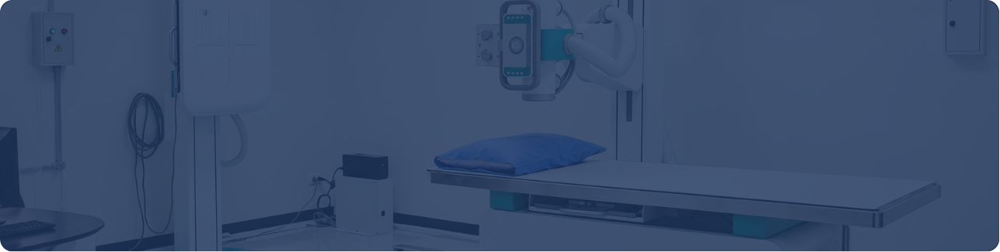
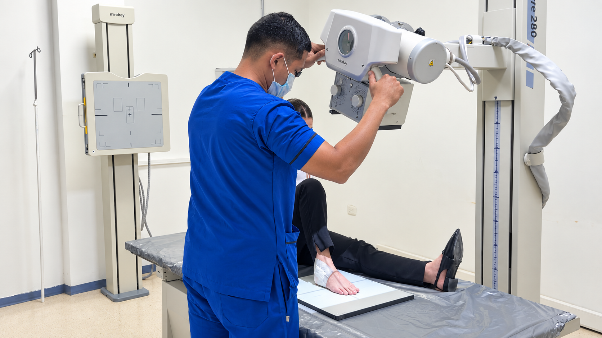
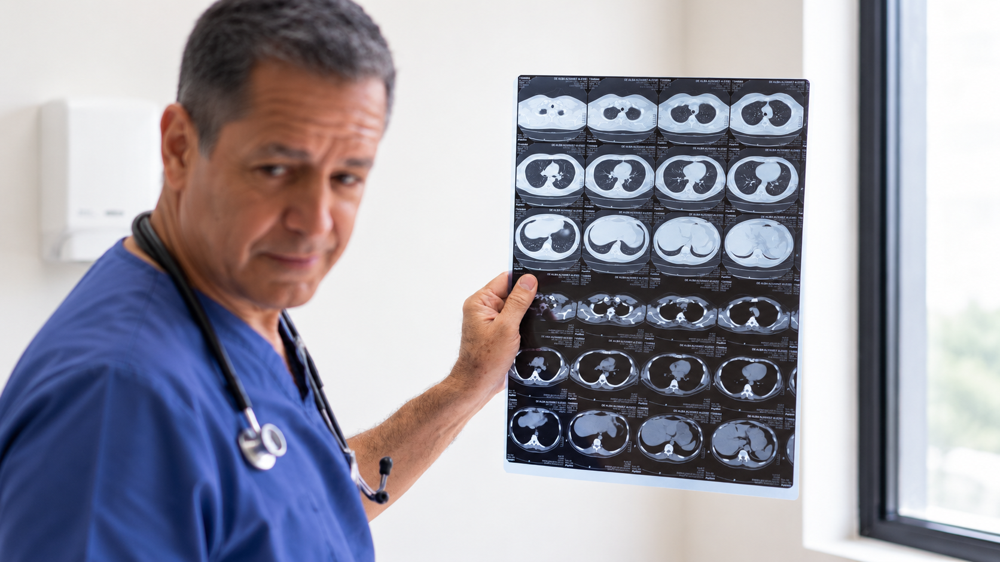

[Botón: Inicio](https://clinicalaesperanza.co/portafolio/)

[Botón: Volver a servicios](https://clinicalaesperanza.co/p-consulta-externa/)

## Radiología

Servicios de diagnóstico por imágenes para apoyar la detección, evaluación y seguimiento de diferentes condiciones de salud.

## Tecnología y precisión diagnóstica

Contamos con tecnología especializada para obtener imágenes claras y apoyar decisiones médicas oportunas.

## Diagnóstico a través de imágenes

Nuestros estudios ayudan a evaluar diferentes condiciones de salud con precisión y acompañamiento profesional.

#### Radiografía

Evaluación e intervención psicológica orientada al manejo de dificultades emocionales, conductuales y relacionales, favoreciendo el bienestar y las herramientas personales para afrontar diferentes situaciones.

#### Ecografía

Evaluación e intervención psicológica orientada al manejo de dificultades emocionales, conductuales y relacionales, favoreciendo el bienestar y las herramientas personales para afrontar diferentes situaciones.

## Precisión en cada imagen

Cada estudio se realiza con atención a tus necesidades y con el respaldo de un equipo especializado.

# ¿Necesitas un estudio diagnóstico?

Consulta nuestros servicios de Radiología y agenda tu estudio.

[Botón: Conoce más](#)
