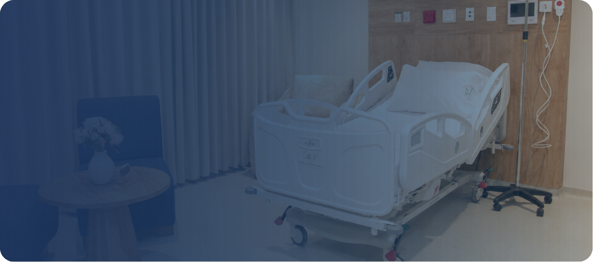
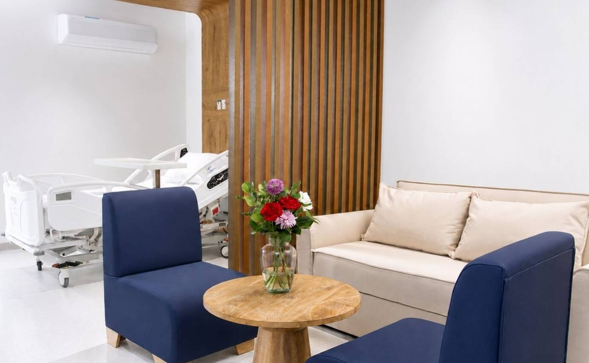
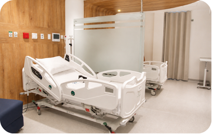
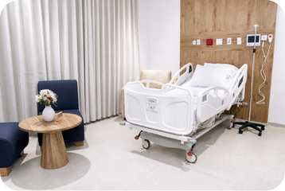
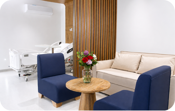

[Botón: Volver a servicios](https://clinicalaesperanza.co/portafolio/)

[Botón: Hospitalización](https://clinicalaesperanza.co/p-hospitalizacion/)

[Botón: Pedriatría](https://clinicalaesperanza.co/p-pediatria/)

[Botón: Suite VIP](https://clinicalaesperanza.co/p-suite-vip/)

## Suite VIP

Nuestra experiencia premium de hospitalización.

La Suite Serena ofrece el máximo nivel de comodidad, con un espacio exclusivo que combina privacidad, amplitud y servicios diferenciados para el paciente y su acompañante.

#### Recuperarse también significa sentirse como en casa

Nuestras Suites VIP fueron diseñadas para brindar una experiencia superior de hospitalización, ofreciendo mayor privacidad, confort y servicios exclusivos para que el paciente y su acompañante disfruten de una estancia más tranquila y agradable.

#### Opciones de hospitalización

#### Habitación Estándar

#### Comodidad y bienestar para tu recuperación.

###### La Habitación Estándar ofrece un espacio cómodo, seguro y funcional, pensado para brindar una estancia agradable con la calidad y el cuidado que caracterizan a la Clínica La Esperanza.

Habitación privada

Baño privado

Aire acondicionado

Televisión

Alimentación

Atención médica

Enfermería 24h

Acompañante

[Botón: Conoce más](https://clinicalaesperanza.co/p-detalle-habitacion-estandar/)

#### Habitación Plus

#### Mayor confort para una estancia más agradable.

La Habitación Plus está diseñada para quienes desean disfrutar de un ambiente más amplio, moderno y confortable durante su proceso de recuperación.

Habitación privada

Baño privado

Aire acondicionado

Televisión

Nevera

Estación de café

Espacios amplios

Acompañante

[Botón: Conoce más](https://clinicalaesperanza.co/p-detalle-habitacion-plus/)

[Botón: Premium](#)

#### Suite Serena

#### Nuestra experiencia premium de hospitalización.

La Suite Serena representa el máximo nivel de comodidad dentro de nuestra institución. Fue diseñada para brindar una experiencia exclusiva durante la hospitalización, combinando privacidad, amplitud y servicios diferenciados para el paciente y su acompañante.

Suite privada

Baño privado

Kit de aseo

Televisión

Menú especial

Estación de café

Experiencia premium

Nevera

Espacio acompañante

Menú dif. acompañante

[Botón: Conoce más](https://clinicalaesperanza.co/p-detalle-suite-serena/)

#### Compara nuestras habitaciones

Característica

Estándar

Plus

Suite Serena

Habitación privada

✓

Baño privado

✓

Aire acondicionado

✓

Televisión

✓

Nevera

—

✓

Estación de café

—

✓

Kit de aseo

—

✓

Espacio para acompañante

Básico

Amplio

Premium

Menú especial

—

✓

Experiencia premium

—

✓

## Suite VIP​

En Clínica La Esperanza trabajamos cada día para brindar una experiencia de hospitalización segura, humana y confortable, acompañando a nuestros pacientes y sus familias con calidad, calidez y compromiso.​

[Botón: Solicitar información](#)
