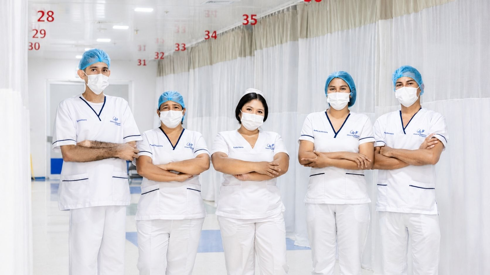

[Botón: Volver a servicios](https://clinicalaesperanza.co/portafolio/)

## Atención de urgencias 24 horas

En Clínica La Esperanza trabajamos cada día para brindar una experiencia de hospitalización segura, humana y confortable, acompañando a nuestros pacientes y sus familias con calidad, calidez y compromiso.​

Urgencias Adultos

Atención médica para pacientes adultos que requieren valoración y manejo oportuno.

Urgencias Pediátricas

Atención para niños y adolescentes en un espacio pensado para sus necesidades.

Modelo de atención en urgencias

Atención médica para pacientes adultos que requieren valoración y manejo oportuno.

#### ¿Cuándo acudir?

Ante situaciones que requieran atención médica inmediata, como dolor intenso, dificultad para respirar, pérdida del conocimiento, sangrado abundante, traumatismos o cambios súbitos en el estado de salud.

# Estamos para atenderte

# Clínica La Esperanza
