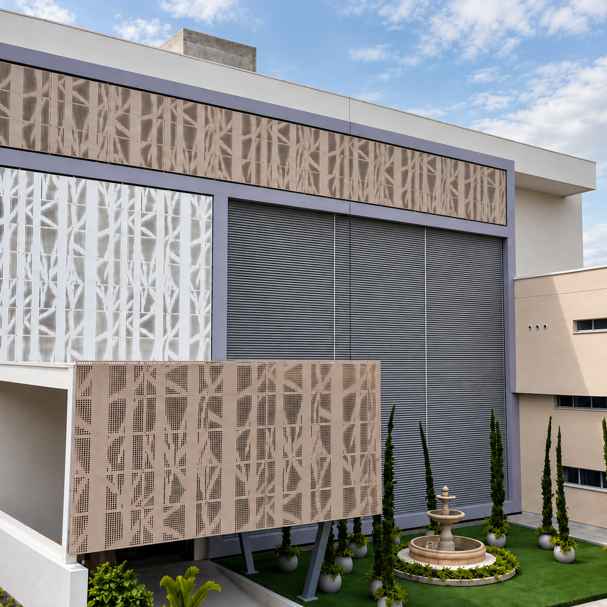
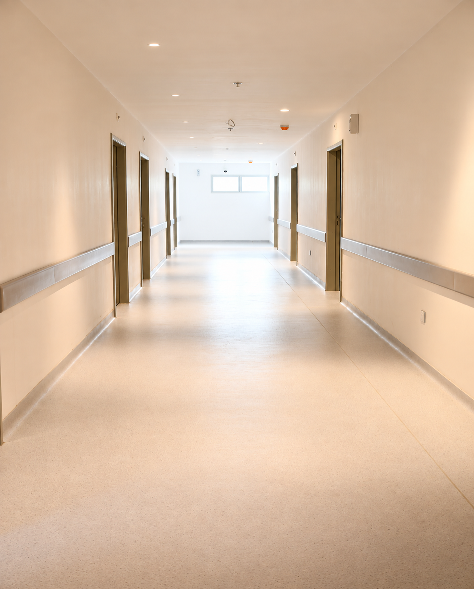
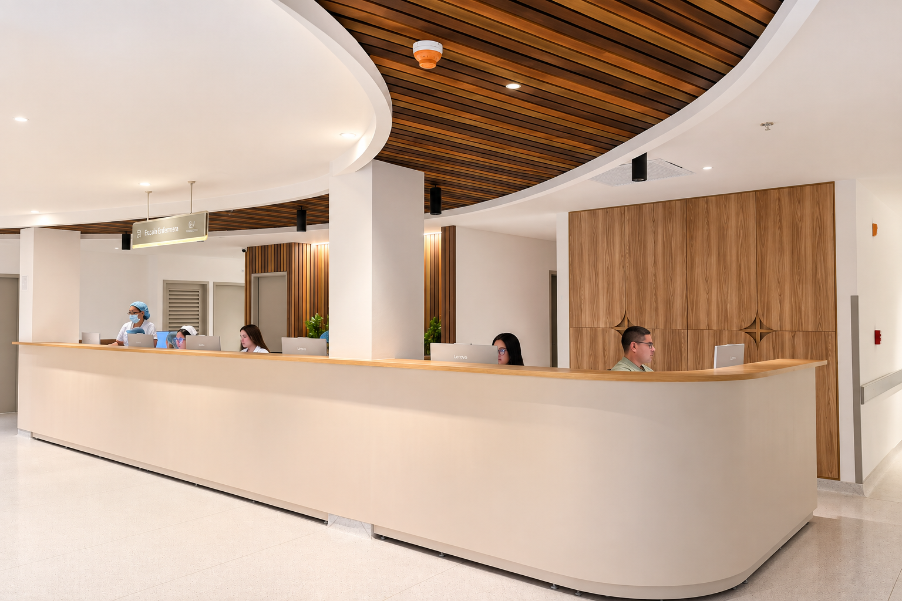
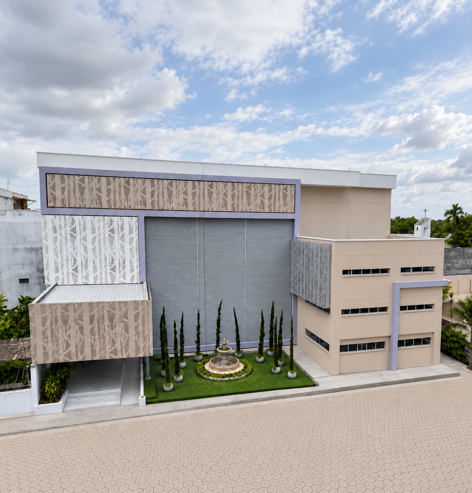
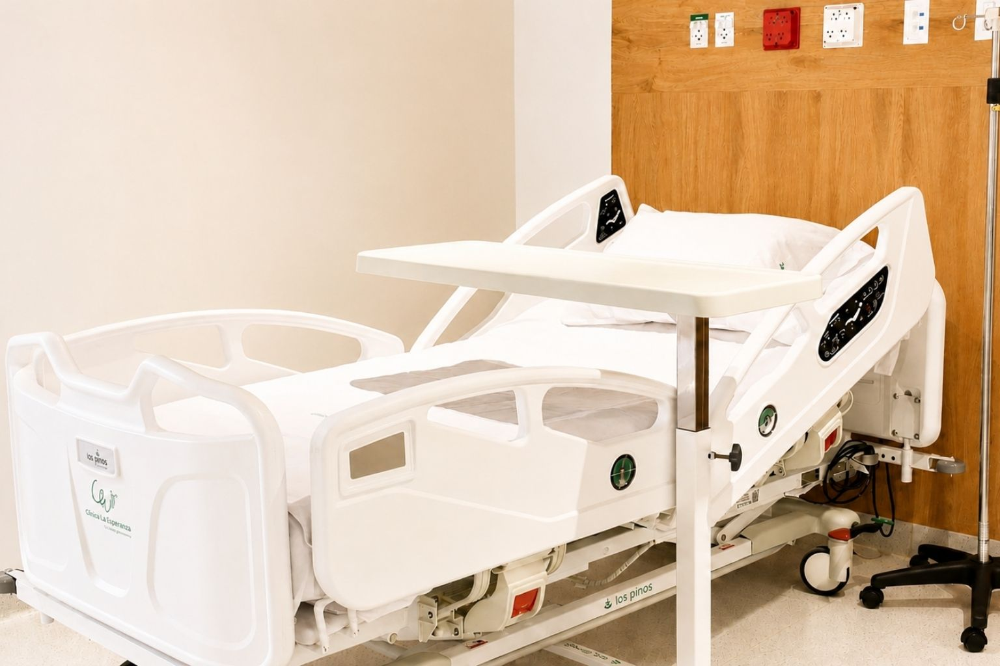
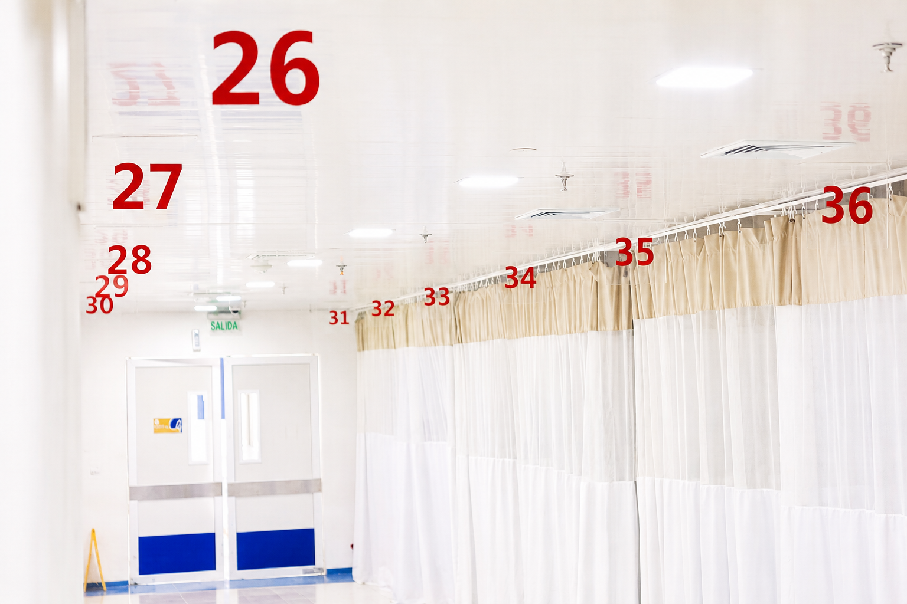
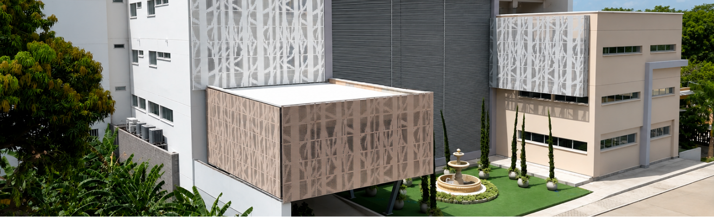

ClinicalaEsperanza.co

60(4) 784 8903

Calle 12 #4-58, B/ Buenavista, Montería, Córdiba

- Inicio

- ¿Quiénes somos?

- Nuestros servicios

- Nuestras especialidades Medicina interna NeumologíaNefrologíaCardiología HemodinamiaElectrofisiología NeurologíaGastroenterologíaHematologíaInfectologíaReumatología (consulta externa) Ginecología Materno Fetal (Perinatología)Ginecología OncológicaGinecología Laparoscópica Cirugía general Cirugía PancreatohepatobiliarCirugía de tórax Pediatría Cardiología PediátricaNeumología pediátricaInfectología pediátricaNeonatologíaHemato-oncología pediátricaEndocrinología pediátricaNefrología pediátricaNeurocirugía pediátricaOftalmología pediátricaGastroenterología pediátricaCirugía pediátrica Ortopedia y traumatología Ortopedia OncológicaArtroscopiaOrtopedia ReconstructivaCirugía de HombroRevisión de PrótesisCirugía de Columna Neurocirugía Neurocirugía – Medicina del Dolor Radiología Radiología intervencionistaImágenes Cardíacas Salud Mental PsiquiatríaPsicología UrologíaCirugía CardiovascularCirugía PlásticaCirugía MaxilofacialOtorrinolaringologíaOftalmología y OculoplastiaFonoaudiologíaNutrición y DietéticaFisioterapia Rehabilitación CardíacaTerapia física y rehabilitación Medicina Física y Rehabilitación (Fisiatría)AlergologíaDermatología

- Nueva infraestructura

- Historias

[formulario: campos = post_types, s]

Inicio¿Quiénes somos?Nuestros serviciosNuestras especialidades Medicina interna NeumologíaNefrologíaCardiología HemodinamiaElectrofisiología NeurologíaGastroenterologíaHematologíaInfectologíaReumatología (consulta externa) Ginecología Materno Fetal (Perinatología)Ginecología OncológicaGinecología Laparoscópica Cirugía general Cirugía PancreatohepatobiliarCirugía de tórax Pediatría Cardiología PediátricaNeumología pediátricaInfectología pediátricaNeonatologíaHemato-oncología pediátricaEndocrinología pediátricaNefrología pediátricaNeurocirugía pediátricaOftalmología pediátricaGastroenterología pediátricaCirugía pediátrica Ortopedia y traumatología Ortopedia OncológicaArtroscopiaOrtopedia ReconstructivaCirugía de HombroRevisión de PrótesisCirugía de Columna Neurocirugía Neurocirugía – Medicina del Dolor Radiología Radiología intervencionistaImágenes Cardíacas Salud Mental PsiquiatríaPsicología UrologíaCirugía CardiovascularCirugía PlásticaCirugía MaxilofacialOtorrinolaringologíaOftalmología y OculoplastiaFonoaudiologíaNutrición y DietéticaFisioterapia Rehabilitación CardíacaTerapia física y rehabilitación Medicina Física y Rehabilitación (Fisiatría)AlergologíaDermatología Nueva infraestructuraHistorias

Clínica La Esperanza Montería

Clinica La Esperanza Montería Córdoba Colombia

###### Nueva torre

###### Nuestros servicios

###### Tecnología e infraestructura

# Construimos juntos el futuro de la salud

# Somos una institución de salud de mediana y alta complejidad, comprometida con brindar servicios integrales, seguros y de calidad.

[Botón: Conoce más](https://clinicalaesperanza.co/p-infraestructura/)

# Construimos juntos el

# futuro de la salud

# Somos una institución de salud de mediana y alta complejidad, comprometida con brindar servicios integrales, seguros y de calidad.

[Botón: Conoce más](#NuestrosServicios)

##### ¿Quiénes somos?

Una institución preparada para responder a las necesidades de nuestros pacientes y aliados.

###### Somos una institución prestadora de servicios de salud de mediana y alta complejidad que integra infraestructura, tecnología y talento humano para ofrecer una atención segura, oportuna y centrada en la calidad asistencial.

##### ¿Por qué elegirnos?

##### Crecimiento

##### Capacidad instalada

#### ¿Quiénes somos?

Somos una institución prestadora de servicios de salud de mediana y alta complejidad que integra infraestructura, tecnología y talento humano para ofrecer una atención segura, oportuna y centrada en la calidad asistencial.

window.addEventListener("message", function(event) { if (event.origin !== "https://clinicalaesperanza.co") return; if (event.data.type === "iframeHeight") { const iframe = document.getElementById(event.data.id); if (iframe) { iframe.style.height = event.data.height + "px"; } } });

• Presentación

• Por qué elegirnos

• Capacidad instalada

• Crecimiento

• Presentación

[iframe: https://clinicalaesperanza.co/p-tab-1/]

• Por qué elegirnos

[iframe: https://clinicalaesperanza.co/p-tab-2/]

• Capacidad instalada

[iframe: https://clinicalaesperanza.co/p-tab-3/]

• Crecimiento

[iframe: https://clinicalaesperanza.co/p-tab-4/]

#### Nuestros servicios

##### Oferta asistencial de mediana y alta complejidad, estructurada para responder de manera integral a las necesidades de nuestros pacientes.

HospitalizaciónAtención integral para pacientes que requieren estancia hospitalaria.01UrgenciasAtención integral para pacientes que requieren estancia hospitalaria.02Cuidado críticoAtención integral para pacientes que requieren estancia hospitalaria.03CirugíaAtención integral para pacientes que requieren estancia hospitalaria.04Ginercología y obstetriciaAtención integral para pacientes que requieren estancia hospitalaria.05

#### Nueva infraesctructura

Construimos el futuro de la atención en salud a través de un proyecto de expansión que fortalecerá nuestra capacidad instalada.

Nueva infraesctructura

##### Construimos el futuro de la atención en salud a través de un proyecto de expansión que fortalecerá nuestra capacidad instalada.

[Botón: Conoce más](https://clinicalaesperanza.co/p-infraestructura/)

#### Infraestructura institucional

Hospitalización

Urgencias

Cuidado crítico

#### Nueva infraesctructura

Construimos el futuro de la atención en salud a través de un proyecto de expansión que fortalecerá nuestra capacidad instalada.

Capacidad actual

## 123

Camas habilitadas

Nueva torre

### 7.764 m2

Proyección

## 218

Camas proyectadas

#### Historias que inspiran

Cada historia refleja el compromiso de nuestro equipo con una atención centrada en las personas.

Johan Cruz Martinez

Cirugía de alta complejidad en la que se retiró el quiste de la vía biliar y se reconstruyó el paso de la bilis.

Cirugía de columna

Intervención quirúrgica especializada para corregir la causa del dolor crónico.

Parto humanizado

Experiencia de nacimiento respetuosa, segura y acompañada.

#### Contacto

Comprometidos con la salud, preparados para el futuro.

Calle 12 #4-58, Barrio Buenavista, Montería – Colombia.

info@clinicalaesperanza.co

+6047848903

#### Menú

InicioSobre nosotrosNuestros serviciosAgendaContacto

#### Contáctanos

+604: 784 8903

Dirección: Calle 12 # 4- 58

Barrio Buenavista

Montería - Córdoba

#### Siguénos

Clínica La Esperanza © 2026.
