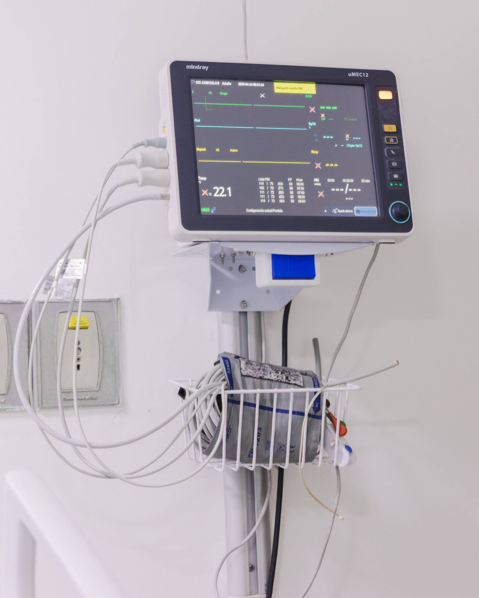

## Hospitalización

## Hospitalización General Adulto

Brindamos atención de alta calidad en hospitalización general, enfocándonos en la recuperación integral del paciente en un entorno seguro, cómodo y humanizado. Nuestros espacios están equipados con tecnología médica adecuada para atender las necesidades clínicas.

## Hospitalización General Adulto

Brindamos atención de alta calidad en hospitalización general, enfocándonos en la recuperación integral del paciente en un entorno seguro, cómodo y humanizado. Nuestros espacios están equipados con tecnología médica adecuada para atender las necesidades clínicas.

Ponte en contacto Información de contactoBarrio Buenavista. Calle 12 #4-58 Montería, Colombia. info@clinicalaesperanza.co
