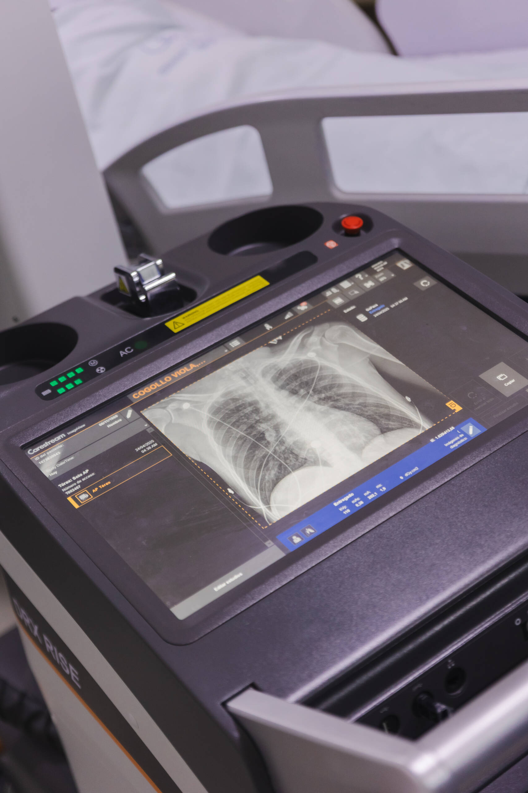

## Cirugía de tórax

La cirugía de tórax es una subespecialidad que se centra en el tratamiento quirúrgico de enfermedades y condiciones que afectan el tórax, incluidos los pulmones, el mediastino y las estructuras óseas. En la Clínica La Esperanza, nuestro equipo de cirujanos torácicos está altamente capacitado para manejar una variedad de patologías benignas y malignas con un enfoque en la precisión y la recuperación óptima del paciente.

Ofrecemos los siguientes servicios:

- Manejo de fracturas costales: Tratamiento quirúrgico para reparar fracturas en las costillas, aliviando el dolor y restaurando la función respiratoria.

- Biopsias en las distintas estructuras del tórax: Procedimientos para obtener muestras de tejido de los pulmones, mediastino y otras áreas del tórax para diagnóstico preciso de enfermedades.

- Corrección de malformaciones torácicas: Intervenciones quirúrgicas para corregir deformidades en la estructura del tórax que pueden afectar la respiración y la función pulmonar.

- Extracción de cuerpos extraños en pared torácica: Remoción de objetos que pueden estar atrapados en la pared torácica, previniendo complicaciones y mejorando el bienestar del paciente.

- Drenaje de hemotórax: Procedimiento para eliminar la acumulación de sangre en el espacio pleural, aliviando la presión sobre los pulmones y facilitando la recuperación.

- Manejo de derrame pleural crónico: Tratamiento de la acumulación de líquido en el espacio pleural que puede causar dificultad respiratoria y otras complicaciones.

En la Clínica La Esperanza, estamos comprometidos con el uso de técnicas avanzadas y un enfoque personalizado para asegurar el mejor cuidado torácico posible. Si necesitas atención especializada para afecciones torácicas, te invitamos a consultarnos. Estamos aquí para ofrecerte el apoyo y tratamiento que necesitas para una recuperación exitosa. ¡Tu salud torácica es nuestra prioridad!gubergren, no sea takimata sanctus est Lorem ipsum dolor sit amet. Lorem ipsum dolor sit amet, consetetur sadipscing elitr.

Ponte en contacto Información de contactoBarrio Buenavista. Calle 12 #4-58 Montería, Colombia. info@clinicalaesperanza.co
