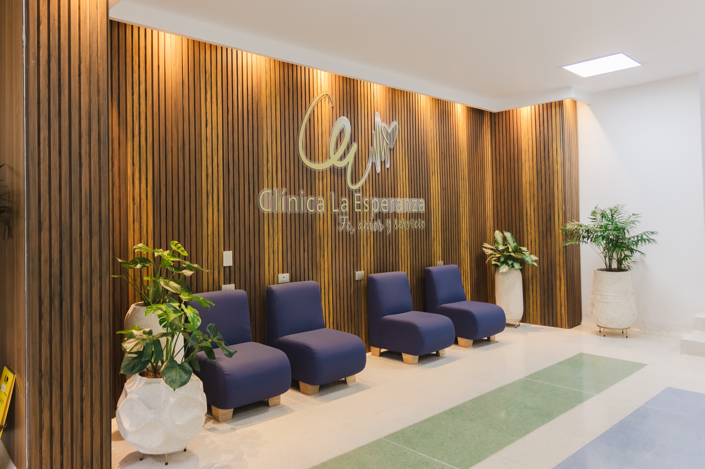
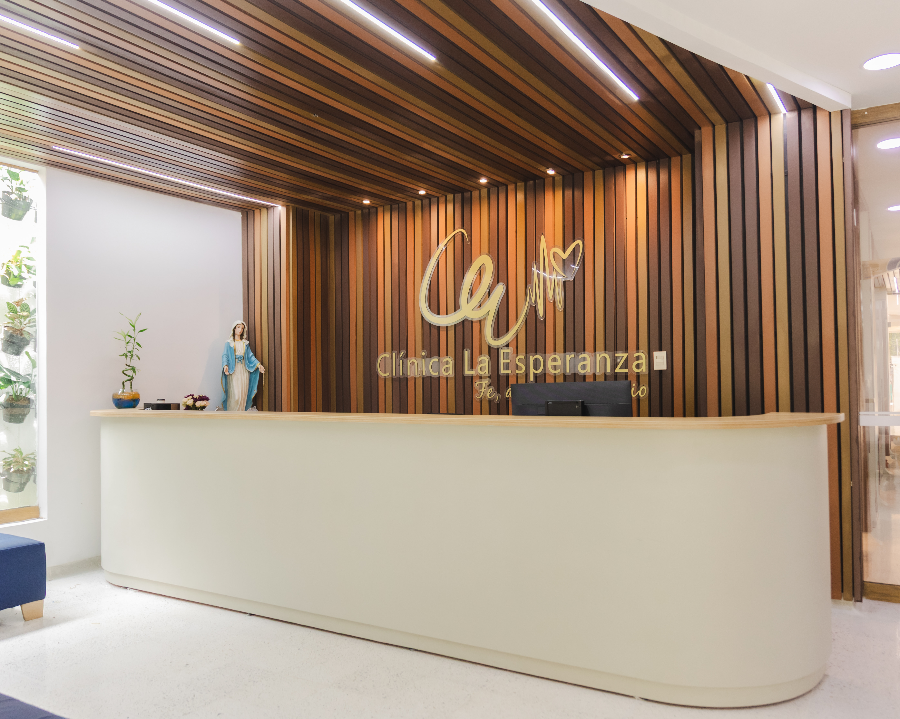

# Contáctenos

# Solicitar cita

# App Clem

### Nuestra capacidad

# 80

##### Camas de hospitalización

# 20

##### Camas pediátricas

# +15

##### Años de experiencia

# 10

##### Servicios de diagnóstico

### Nuestra historia

Clínica La Esperanza -Evaluamos IPS es una sociedad de responsabilidad limitada creada en el año 2006, por un grupo de amigos que deciden conformar una IPS para prestar servicios de salud de primer nivel de atención.

Inició prestando los servicios en la Calle 22 entre carreras 3ra y 4ta. Posteriormente, debido a los aumentos de cobertura por parte del Municipio y al trabajo arduo de la administración Evaluamos se ve en la necesidad de trasladarse a una nueva sede ubicada en la Calle 27 con Carrera 15 en el barrio Costa de Oro.

Luego, debido a la consecución de nuevos contratos y al crecimiento de la cobertura del Régimen Subsidiado en Montería, Evaluamos decide crecer, trasladándose a la Calle 12 No. 4 – 58, donde se maneja II y III nivel de atención.

Desde los inicios la visión fue crear una institución cuyos usuarios fueran pacientes pertenecientes al régimen subsidiado, con el fin de brindarle a esta población vulnerable una atención con altos estándares de calidad, como las mejores clínicas del país.

Nuestra misión

Brindar atención en salud de alta complejidad actuando de manera ética, oportuna, segura y eficiente, a través de la evidencia científica, trato humanizado, el uso de las tecnologías en salud y la mejora continua de nuestro modelo de atención.

Nuestra visión

Ser reconocidos en la región por nuestros resultados clínicos mediante la implementación de un modelo de atención eficiente, integral, humano y seguro que brinde la mejor atención a nuestros usuarios.

### Nuestros valores y principios

👩‍⚕️

👨‍⚕️👩‍⚕️

⚖️

⭐

📋

Nuestros principios

1

2

3

4

5

6

Clínica La Esperanza es una Institución Prestadora de Servicios de Salud de mediana y alta complejidad, con gran compromiso social que busca brindarle a sus usuarios altos estándares de calidad.

Camas

8

0

8

0

Atención para adultos

Camas

8

0

8

0

Camas de pacientes pediátricos

# Reseña histórica

Clínica La Esperanza -Evaluamos IPS es una sociedad de responsabilidad limitada creada en el año 2006, por un grupo de amigos que deciden conformar una IPS para prestar servicios de salud de primer nivel de atención.

Inició prestando los servicios en la Calle 22 entre carreras 3ra y 4ta. Posteriormente, debido a los aumentos de cobertura por parte del Municipio y al trabajo arduo de la administración Evaluamos se ve en la necesidad de trasladarse a una nueva sede ubicada en la Calle 27 con Carrera 15 en el barrio Costa de Oro.

Luego, debido a la consecución de nuevos contratos y al crecimiento de la cobertura del Régimen Subsidiado en Montería, Evaluamos decide crecer, trasladándose a la Calle 12 No. 4 – 58, donde se maneja II y III nivel de atención.

Desde los inicios la visión fue crear una institución cuyos usuarios fueran pacientes pertenecientes al régimen subsidiado, con el fin de brindarle a esta población vulnerable una atención con altos estándares de calidad, como las mejores clínicas del país.

# Misión

Brindar atención en salud de alta complejidad actuando de manera ética, oportuna, segura y eficiente, a través de la evidencia científica, trato humanizado, el uso de las tecnologías en salud y la mejora continua de nuestro modelo de atención, atendiendo las necesidades en salud de nuestros usuarios y la comunidad en general.

# Visión

Ser reconocidos en la región por nuestros resultados clínicos mediante la implementación de un modelo de atención eficiente, integral, humano y seguro que brinde la mejor atención a nuestros usuarios.

# Nuestros valores

- Trato Humanizado

- Trabajo en equipo

- Ética e integridad

- Perseverancia

- Responsabilidad.

# Principios organizacionales

- Respetar la filosofía empresarial.

- Velar por el cumplimiento de los derechos y deberes de nuestros pacientes y atención de las necesidades de nuestros usuarios y demás interesados.

- Propender por la integralidad en la prestación de los servicios que ofertamos.

- Cumplir con la legislación vigente y los requisitos organizacionales.

- Fomentar una cultura de seguridad para los pacientes, su familia y acompañantes y nuestros usuarios internos.

- Mejorar continuamente nuestros procesos y servicios a través de estrategias eficientes.
