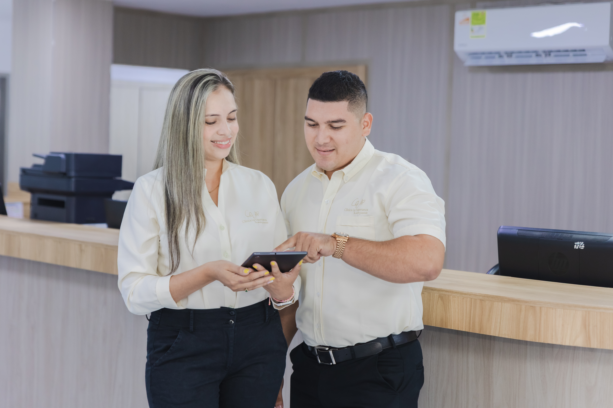

Clínica la esperanza

# Nuestros usuarios

##### En Clínica La Esperanza velamos por el bienestar y satisfacción de nuestros usuarios desde la Coordinación de SIAU (Sistema de Información de Atención al Usuario).

##### Desde Coordinación SIAU se extiende la invitación a la comunidad que quiera formar parte de la alianza de usuarios. Pueden inscribirse en la oficina de SIAU en primer piso y las reuniones de la Alianza de Usuarios tienen una frecuencia de cada tres meses.

# Nuestro usuarios

Acompañamos, escuchamos y mejoramos juntos.

[Botón: Quiero hacer parte de la Alianza de Usuarios](https://wa.me/573044748399)

### Compromisos con nuestros usuarios

En Clínica La Esperanza trabajamos por el bienestar y la satisfacción de nuestros usuarios, brindando una atención cercana, oportuna y humanizada.

A través del SIAU y la Alianza de Usuarios, promovemos la participación, la escucha activa y la mejora continua de nuestros servicios.

👤

## Alianza de usuarios

Tu voz hace parte de nuestra mejora continua

- ✓ Inscripción presencial en la oficina SIAU

- ✓ Reuniones cada tres (3) meses

- ✓ Espacio abierto para propuestas y acompañamiento institucional

### Voces de quienes ya confiaron en nosotros

##### Cada historia representa un momento importante en la vida de nuestros pacientes. Aquí compartimos algunas experiencias que reflejan nuestro compromiso con una atención segura, humana y cercana.

Laura Sofia Restrepo

Parto humanizado

Parto humanizado con acompañamiento continuo y la presencia de su pareja durante todo el proceso, en un entorno seguro y respetuoso, brindando apoyo emocional constante.

[Botón: Leer historia completa](#)

Johan Cruz Martínez

Parto humanizado

Cirugía de alta complejidad en la que se retiró el quiste de la vía biliar y se reconstruyó el paso de la bilis hacia el intestino, permitiendo restablecer su funcionamiento normal..

[Botón: Leer historia completa](#)

Laura Sofia Restrepo

Parto humanizado

Intervención quirúrgica especializada en la columna para corregir la causa del dolor crónico, estabilizar la zona afectada y aliviar la compresión, permitiendo mejorar su movilidad y calidad de vida.

[Botón: Leer historia completa](#)

### Tu opinión nos ayuda a seguir mejorando la atención

[Botón: Comparte tu experiencia con nosotros](#)
